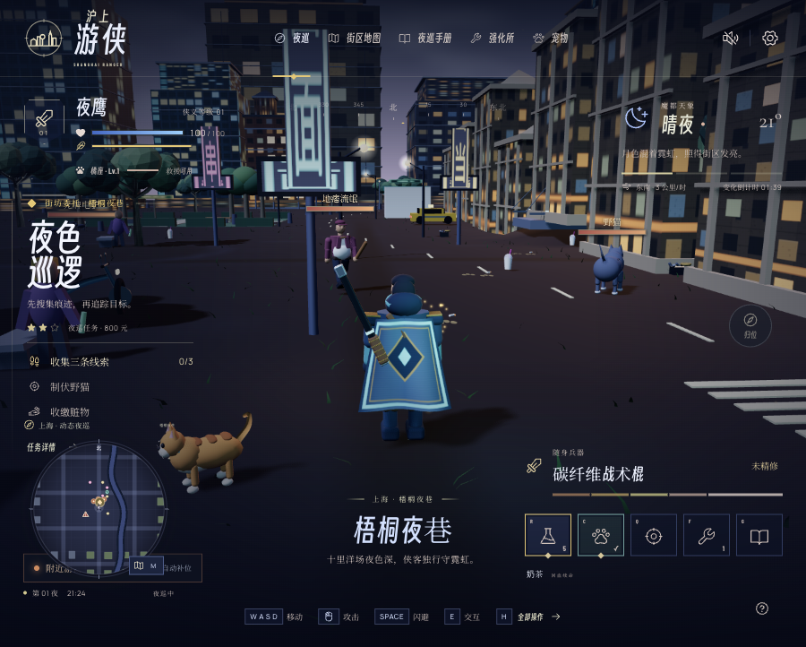
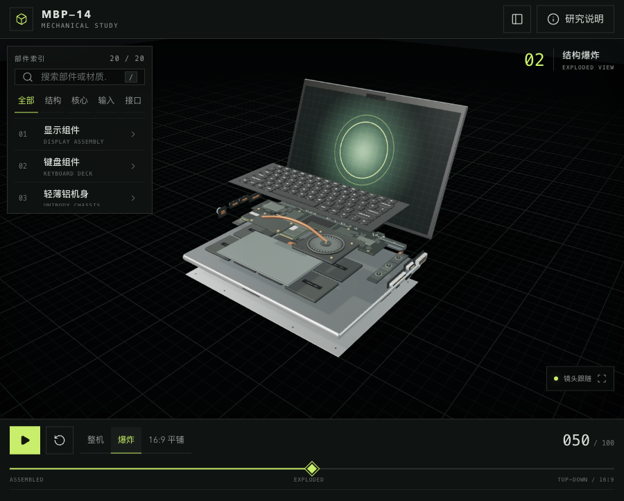
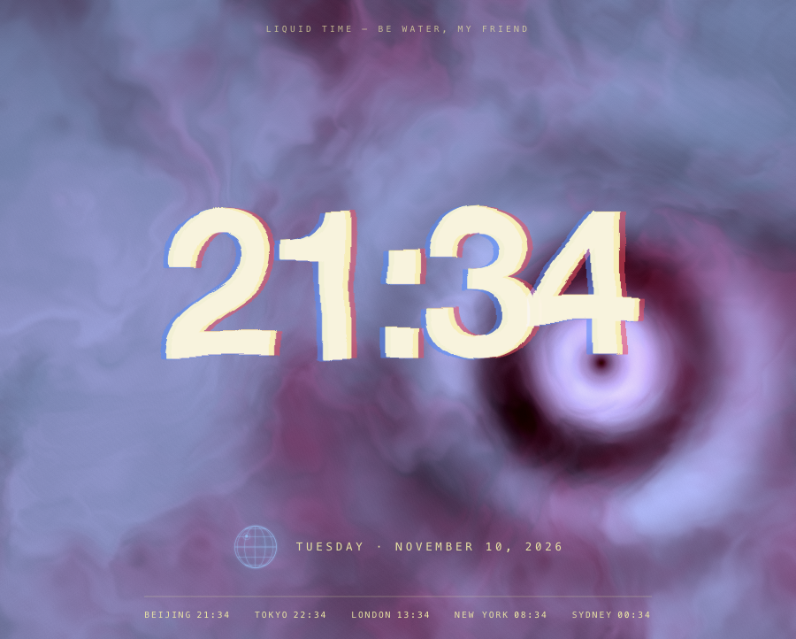
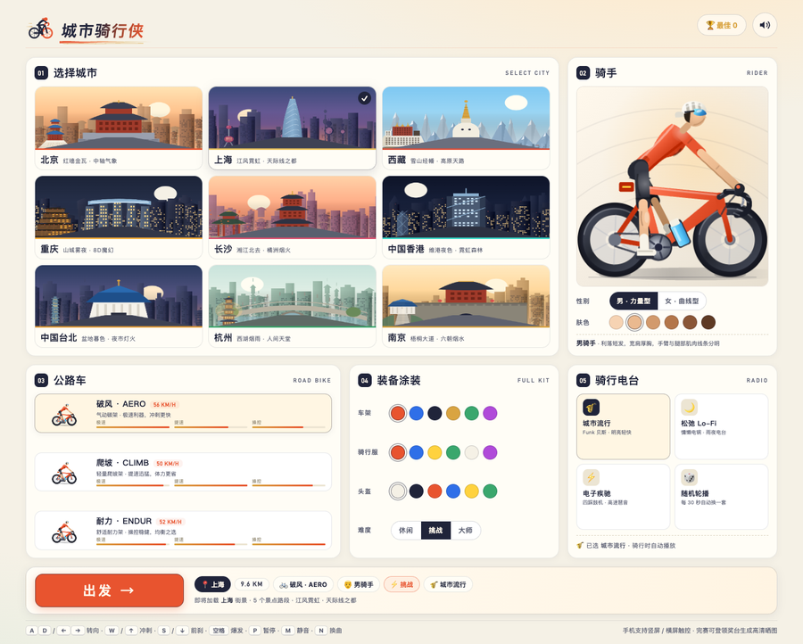

<div align="center">

# Art & Creativity

Creative web experiences, browser games, and interactive 3D studies built with AI assistance.

[简体中文](README.md) · [English](README.en.md) · [日本語](README.ja.md)

</div>

> **Free for noncommercial purposes. Commercial uses outside the license’s permitted purposes require separate written authorization.** [Licensing and contact](LICENSING.md)

## Project gallery

<table>
<tr>
<td width="50%" valign="top">
<a href="shanghai-ranger/"></a>
<h3>Shanghai Ranger · 沪上游侠</h3>
<p>A third-person night patrol through Shanghai-inspired streets. Investigate clues, subdue targets, and raise three independent pet companions.</p>
<p><a href="shanghai-ranger/">Source & guide</a></p>
</td>
<td width="50%" valign="top">
<a href="niuma-week-game/"></a>
<h3>Office Survival · 牛马求生记</h3>
<p>Survive a week at a fictional company. Three career tracks and eleven personas shape the story, performance review, and ending.</p>
<p><a href="https://niuma-week-game.vercel.app/">Play online</a> · <a href="niuma-week-game/">Source & guide</a></p>
</td>
</tr>
<tr>
<td width="50%" valign="top">
<a href="macbook-pro-mechanical-study/"></a>
<h3>MBP—14 · Mechanical Study</h3>
<p>Move between assembled, exploded, and top-down layouts to explore 20 components. A visual study, not repair-grade CAD.</p>
<p><a href="https://3d-mac-book.ok.kimi.link/">Explore online</a> · <a href="macbook-pro-mechanical-study/">Source & guide</a></p>
</td>
<td width="50%" valign="top">
<a href="liquidtime/"></a>
<h3>Liquid Time · 流体时间</h3>
<p>Stir a fluid background with the pointer. Melting numerals, time-of-day colors, and clocks for five cities keep time in motion.</p>
<p><a href="#run-locally">Run locally</a> · <a href="liquidtime/">Source & guide</a></p>
</td>
</tr>
<tr>
<td width="50%" valign="top">
<a href="city-rider/"></a>
<h3>City Rider · 城市骑行侠</h3>
<p>Road-bike time trials through nine Chinese cities. Dodge traffic, hit checkpoints, chain coin combos, and finish with a shareable podium poster.</p>
<p><a href="#run-locally">Run locally</a> · <a href="city-rider/">Source & guide</a></p>
</td>
<td width="50%" valign="top"></td>
</tr>
</table>

Screenshots show local builds of `main`. Shanghai Ranger v1.0.0 is in development in [PR #2](https://github.com/Songhonglei/art-creativity/pull/2) and has not been merged into `main`.

<a id="run-locally"></a>

## Run locally

Liquid Time, Office Survival, and City Rider need no frontend dependencies. Clone the repository and start a static server:

```bash
git clone https://github.com/Songhonglei/art-creativity.git
cd art-creativity
python3 -m http.server 8080 --bind 127.0.0.1
```

Open [Liquid Time](http://127.0.0.1:8080/liquidtime/), [Office Survival](http://127.0.0.1:8080/niuma-week-game/), or [City Rider](http://127.0.0.1:8080/city-rider/).

MBP—14 and Shanghai Ranger require Node.js 22.16+. In a second terminal, return to the repository root, then install dependencies and start the selected project:

```bash
cd macbook-pro-mechanical-study
npm ci
npm run dev
```

For Shanghai Ranger, enter `shanghai-ranger/` instead and run the same install and start commands. Open the local URL printed in the terminal. Use `npm run build` for a production build. Projects maintain their dependencies and saves separately.

## Project guides

| Project | Experience | Stack |
| --- | --- | --- |
| [Shanghai Ranger](shanghai-ranger/) | City patrols, combat, and pet progression | Vite + React + Three.js |
| [Office Survival](niuma-week-game/) | Workplace choices and persistent career records | HTML / CSS / JavaScript |
| [City Rider](city-rider/) | Nine-city cycling, power-ups, and podium posters | HTML / CSS / Canvas / WebAudio |
| [MBP—14](macbook-pro-mechanical-study/) | 3D mechanical layouts and component exploration | Vite + Three.js |
| [Liquid Time](liquidtime/) | Fluid clock and world time zones | HTML / CSS / WebGL |

Language links switch the repository documentation. Most application interfaces are currently in Chinese.

## License

Copyright-holder-owned code and original content supplied with the software use the [PolyForm Noncommercial License 1.0.0](LICENSE). This is source-available software with noncommercial restrictions, not OSI-defined open source. Third-party dependencies, fonts, and assets retain their own licenses. Rights already granted under earlier versions are not retroactively revoked. See [LICENSING.md](LICENSING.md) for scope and commercial licensing.
