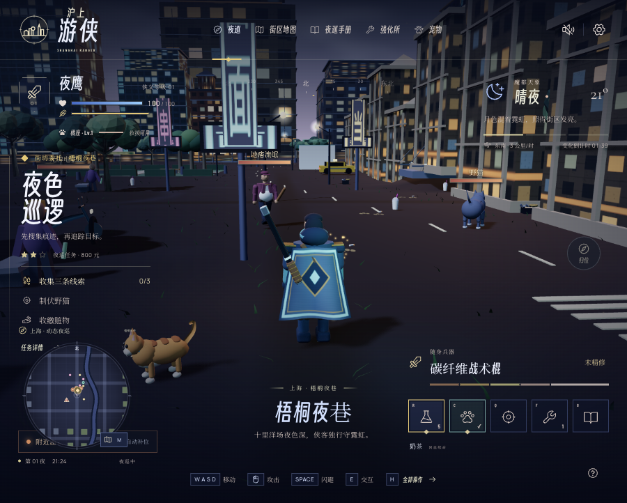
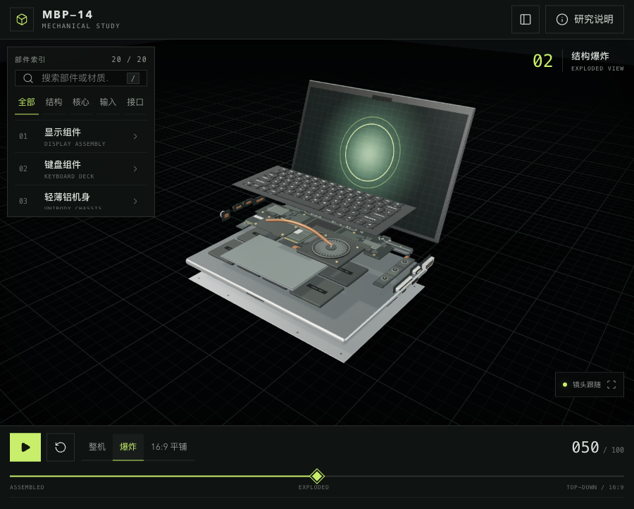
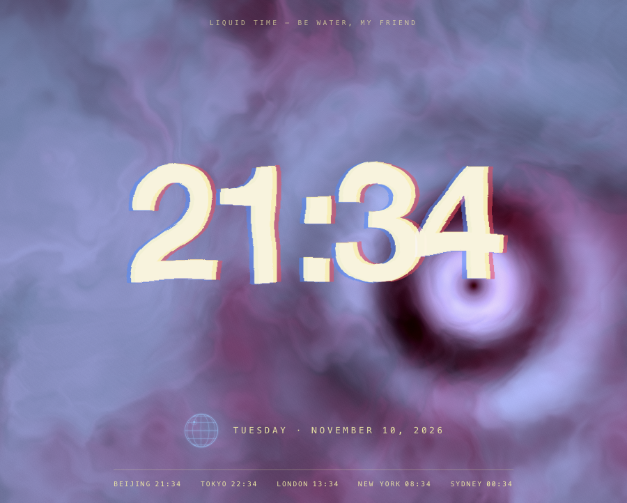

<div align="center">

# Art & Creativity

AI を活用して制作した、創作 Web ページ、ブラウザゲーム、インタラクティブな 3D 作品。

[简体中文](README.md) · [English](README.en.md) · [日本語](README.ja.md)

</div>

> **非商用目的では無料で利用できます。ライセンスの許可範囲外の商用利用には、別途書面による許諾が必要です。** [ライセンスと連絡先](LICENSING.md)

## 作品ギャラリー

<table>
<tr>
<td width="50%" valign="top">
<a href="shanghai-ranger/"></a>
<h3>Shanghai Ranger · 沪上游侠</h3>
<p>上海をモチーフにした街を巡る三人称視点のゲーム。手がかりを調べ、標的を制圧し、3 匹のペットを育てます。</p>
<p><a href="shanghai-ranger/">ソースと説明</a></p>
</td>
<td width="50%" valign="top">
<a href="niuma-week-game/"></a>
<h3>Office Survival · 牛马求生记</h3>
<p>架空の会社で一週間を生き抜く選択型ゲーム。3 つの職位と 11 種類の人物像によって、物語と評価、結末が変わります。</p>
<p><a href="https://niuma-week-game.vercel.app/">ブラウザで遊ぶ</a> · <a href="niuma-week-game/">ソースと説明</a></p>
</td>
</tr>
<tr>
<td width="50%" valign="top">
<a href="macbook-pro-mechanical-study/"></a>
<h3>MBP—14 · 機械スタディ</h3>
<p>組立、分解、俯瞰のレイアウトを連続的に切り替え、20 個の部品を探索します。修理用 CAD ではなく、視覚的な研究作品です。</p>
<p><a href="https://3d-mac-book.ok.kimi.link/">オンラインで見る</a> · <a href="macbook-pro-mechanical-study/">ソースと説明</a></p>
</td>
<td width="50%" valign="top">
<a href="liquidtime/"></a>
<h3>Liquid Time · 流体时间</h3>
<p>ポインターで流体の背景を動かす時計。溶けるような数字、時間帯に応じた配色、5 都市の時計を表示します。</p>
<p><a href="#run-locally">ローカルで実行</a> · <a href="liquidtime/">ソースと説明</a></p>
</td>
</tr>
</table>

画像は `main` ブランチをローカルで実行したものです。Shanghai Ranger v1.0.0 は [PR #2](https://github.com/Songhonglei/art-creativity/pull/2) で開発中で、`main` には未統合です。

<a id="run-locally"></a>

## ローカルで実行

Liquid Time と Office Survival はフロントエンド依存パッケージのインストールが不要です。リポジトリを取得し、静的サーバーを起動します。

```bash
git clone https://github.com/Songhonglei/art-creativity.git
cd art-creativity
python3 -m http.server 8080 --bind 127.0.0.1
```

[Liquid Time](http://127.0.0.1:8080/liquidtime/) または [Office Survival](http://127.0.0.1:8080/niuma-week-game/) を開きます。

MBP—14 と Shanghai Ranger には Node.js 22.16 以降が必要です。別のターミナルでリポジトリのルートに移動し、対象プロジェクトの依存パッケージをインストールして起動します。

```bash
cd macbook-pro-mechanical-study
npm ci
npm run dev
```

Shanghai Ranger を実行する場合は、代わりに `shanghai-ranger/` に移動して同じコマンドを実行します。ターミナルに表示されたローカル URL を開いてください。本番用のビルドは `npm run build` です。各プロジェクトの依存関係とセーブデータは独立しています。

## プロジェクト別の説明

| プロジェクト | 内容 | 技術構成 |
| --- | --- | --- |
| [Shanghai Ranger](shanghai-ranger/) | 都市の夜間巡回、戦闘、ペット育成 | Vite + React + Three.js |
| [Office Survival](niuma-week-game/) | 職場での選択と周回をまたぐ記録 | HTML / CSS / JavaScript |
| [MBP—14](macbook-pro-mechanical-study/) | 3D 機械レイアウトと部品の探索 | Vite + Three.js |
| [Liquid Time](liquidtime/) | 流体時計と世界のタイムゾーン | HTML / CSS / WebGL |

言語リンクはリポジトリの説明文を切り替えます。アプリの画面は主に中国語です。

## ライセンス

権利者が保有するコードと、ソフトウェアに含まれるオリジナルコンテンツには [PolyForm Noncommercial License 1.0.0](LICENSE) が適用されます。ソースは公開されていますが、非商用制限があるため、OSI の定義によるオープンソースではありません。第三者の依存パッケージ、フォント、素材は各自のライセンスに従います。過去のバージョンで既に付与された権利は遡って撤回されません。適用範囲と商用許諾については [LICENSING.md](LICENSING.md) を参照してください。
