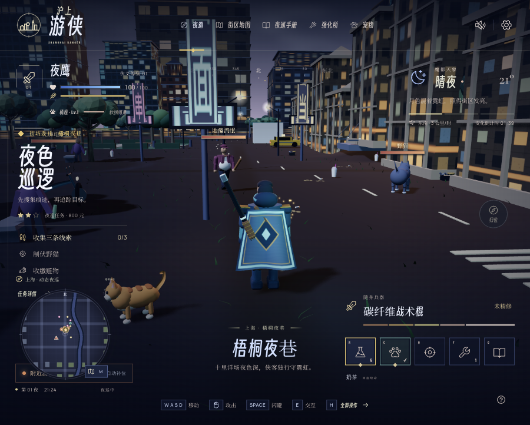
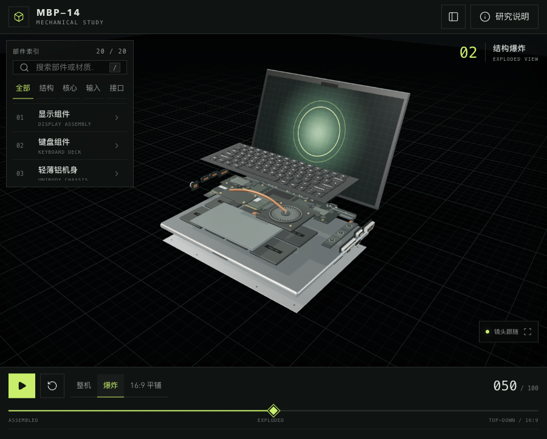
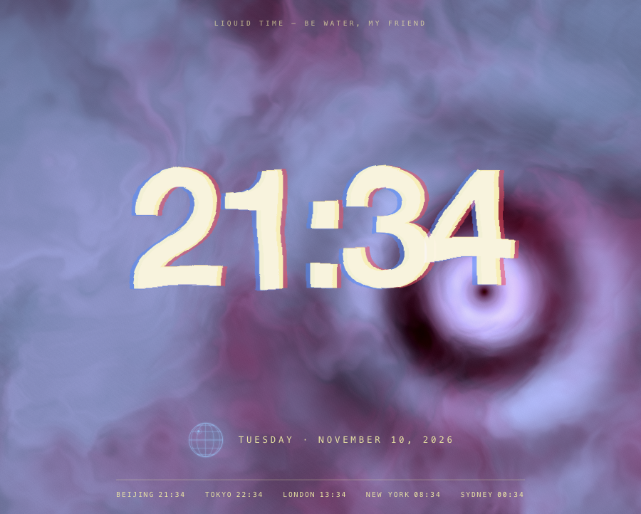
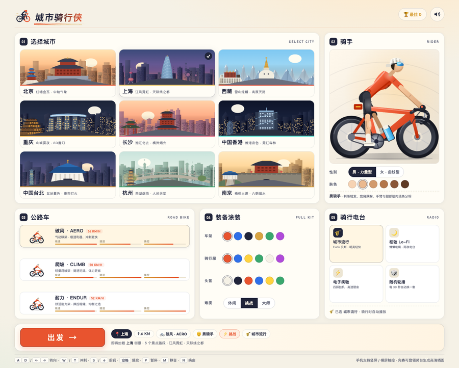

<div align="center">

# Art & Creativity

用 AI 辅助开发的创意网页、小游戏与三维交互作品。

[简体中文](README.md) · [English](README.en.md) · [日本語](README.ja.md)

</div>

> **非商业用途免费；超出许可允许范围的商用须先取得书面授权。** [许可与商用联系](LICENSING.md)

## 作品预览

<table>
<tr>
<td width="50%" valign="top">
<a href="shanghai-ranger/"></a>
<h3>沪上游侠 · Shanghai Ranger</h3>
<p>上海街区里的第三人称夜巡游戏。调查线索、制伏目标，带上三只独立成长的宠物同行。</p>
<p><a href="shanghai-ranger/">源码与说明</a></p>
</td>
<td width="50%" valign="top">
<a href="niuma-week-game/"></a>
<h3>牛马求生记 · Office Survival</h3>
<p>在虚构公司度过一周：三条职级线、十一种人设，选择影响剧情、绩效和结局。</p>
<p><a href="https://niuma-week-game.vercel.app/">在线试玩</a> · <a href="niuma-week-game/">源码与说明</a></p>
</td>
</tr>
<tr>
<td width="50%" valign="top">
<a href="macbook-pro-mechanical-study/"></a>
<h3>MBP—14 · 机械研究台</h3>
<p>整机、爆炸与俯视平铺连续切换，探索 20 个部件。模型用于视觉研究，并非维修级 CAD。</p>
<p><a href="https://3d-mac-book.ok.kimi.link/">在线探索</a> · <a href="macbook-pro-mechanical-study/">源码与说明</a></p>
</td>
<td width="50%" valign="top">
<a href="liquidtime/"></a>
<h3>Liquid Time · 流体时间</h3>
<p>鼠标扰动流体背景，融化字形显示时间；配色随一天变化，并展示五座城市的时区。</p>
<p><a href="#run-locally">本地体验</a> · <a href="liquidtime/">源码与说明</a></p>
</td>
</tr>
<tr>
<td width="50%" valign="top">
<a href="city-rider/"></a>
<h3>城市骑行侠 · City Rider</h3>
<p>九座中国城市的公路车骑行赛。躲车抢检查点，攒连击换星级，完赛生成一张能直接发出去的领奖台晒图。</p>
<p><a href="#run-locally">本地体验</a> · <a href="city-rider/">源码与说明</a></p>
</td>
<td width="50%" valign="top"></td>
</tr>
</table>

截图来自 `main` 分支的本地运行版本。沪上游侠 v1.0.0 正在 [PR #2](https://github.com/Songhonglei/art-creativity/pull/2) 开发，尚未合入 `main`。

<a id="run-locally"></a>

## 本地运行

流体时间、牛马求生记和城市骑行侠无需安装前端依赖。克隆仓库后启动静态服务：

```bash
git clone https://github.com/Songhonglei/art-creativity.git
cd art-creativity
python3 -m http.server 8080 --bind 127.0.0.1
```

打开 [流体时间](http://127.0.0.1:8080/liquidtime/)、[牛马求生记](http://127.0.0.1:8080/niuma-week-game/) 或 [城市骑行侠](http://127.0.0.1:8080/city-rider/)。

MBP—14 和沪上游侠需要 Node.js 22.16+。另开终端并进入仓库根目录，再安装依赖并启动对应项目：

```bash
cd macbook-pro-mechanical-study
npm ci
npm run dev
```

沪上游侠改为进入 `shanghai-ranger/` 后执行同样的安装和启动命令。访问终端打印的本地地址；生产构建使用 `npm run build`。各项目独立维护依赖与存档。

## 项目文档

| 项目 | 内容 | 技术栈 |
| --- | --- | --- |
| [沪上游侠](shanghai-ranger/) | 都市夜巡、战斗与宠物成长 | Vite + React + Three.js |
| [牛马求生记](niuma-week-game/) | 职场剧情选择与跨局档案 | HTML / CSS / JavaScript |
| [城市骑行侠](city-rider/) | 九城骑行、道具连击与领奖台晒图 | HTML / CSS / Canvas / WebAudio |
| [MBP—14](macbook-pro-mechanical-study/) | 三维机械布局与部件探索 | Vite + Three.js |
| [流体时间](liquidtime/) | WebGL 流体时钟与世界时区 | HTML / CSS / WebGL |

以上语言切换适用于仓库文档；应用界面以各项目当前实现为准。

## 许可

自有代码及随软件提供的原创内容采用 [PolyForm Noncommercial 1.0.0](LICENSE)。这是源码公开的非商业许可，不属于 OSI 定义的开源许可。第三方依赖、字体和素材保留各自许可，历史版本已授予的权利不追溯撤销。详见 [LICENSING.md](LICENSING.md)。
