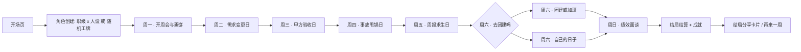

# 《牛马求生记 · 一周打工闯关》网页小游戏 —— 完整设计方案

| 项目 | 内容 |
|---|---|
| 文档版本 | v1.0（待评审） |
| 撰写日期 | 2026-10-13 |
| 游戏类型 | 网页端 · 文字剧情抉择 + 资源管理 + 轻 Roguelite |
| 目标平台 | PC / 手机浏览器（纯前端，自适应，无需后端） |
| 单局时长 | 10 ~ 15 分钟 |
| 内容分级 | 12+，职场讽刺幽默，纯属虚构 |

> **一句话定位**：一周七天，从周一开周会到周日绩效面谈，在互联网公司的"牛鬼蛇神"中活下来——或者体面地跑路。
>
> 开屏免责声明（本身就是个梗）：*本游戏纯属虚构，如有雷同，说明你也在上班。*

---

## 目录

1. 设计目标与核心体验
2. 世界观与美术风格
3. 游戏流程总览
4. 角色系统（职级 × 人设 双维度）
5. 属性系统
6. 核心玩法循环
7. 事件系统
8. 七天关卡设计（逐日主题 + 每日 Boss）
9. 技能与道具系统
10. NPC 关系网
11. 结局与成就系统
12. UI / UX 设计
13. 技术实现方案
14. 数值与平衡
15. 文案风格指南
16. 内容合规与风险
17. 开发里程碑
18. 待确认事项
19. 附录（示例事件 JSON / 黑话词典 / 结局文案）

---

## 1. 设计目标与核心体验

### 1.1 三个情绪锚点

| 锚点 | 玩家感受 | 实现手段 |
|---|---|---|
| **共鸣** | "太真实了，这不就是我司" | 高密度职场黑话、经典名场面事件（画饼、五彩斑斓的黑、已读乱回） |
| **爽感** | "忍了一周，终于反击成功" | 硬刚/反甩锅选项的隐藏高分分支、连锁反杀事件 |
| **黑色幽默** | "又离谱又好笑" | 发疯文学、荒诞选项（在群里发疯反而爆红）、结局的荒诞转折 |

### 1.2 核心体验循环（30 秒一层）

```
看事件（笑） → 做选择（纠结） → 看后果（爽/痛） → 状态变化（权衡下一手）
```

### 1.3 设计原则

- **短平快**：单局 10~15 分钟，随时可放下，下一局想换个人设重来。
- **选择有后果**：没有全局最优解，每个选项都是在"心态 / KPI / 人缘 / 信任"之间做交换；周三的苟且，周四会爆雷（连锁事件机制）。
- **非说教**：不输出"该不该加班/该不该辞职"的价值判断，玩家自己选，结局自己担。
- **梗密度优先**：事件文案是核心资产，好笑 > 好看。

---

## 2. 世界观与美术风格

### 2.1 虚构公司

- **公司名**：卷卷科技（JuánJuán Tech）
- **Slogan**：用爱发电，向死而生
- **背景**：一家 B 轮互联网公司，投资人催增长，老板催融资，中层催汇报，一线催需求。玩家就是这台机器里的一颗螺丝钉（或者掌舵的人，取决于职级线）。

### 2.2 视觉风格：最大的梗就是"长得像办公软件"

整个游戏的 UI **刻意模仿企业 OA / IM 系统的观感**，让玩家一进来就有"我在上班"的既视感：

- 事件卡 = 一条条 IM 消息 / 需求工单 / 审批弹窗；
- 状态栏 = OA 系统侧边栏的个人绩效卡；
- 弹窗 = 钉钉式"@全体成员"红色横幅；
- Boss 事件 = 全屏红色"【紧急】"工单。

### 2.3 配色与字体

| 元素 | 方案 |
|---|---|
| 底色 | 深灰 #1E1F22（夜间办公感）+ 白色内容卡 |
| 强调色 | 警示红 #FF4D4F（紧急需求/@我）、通过绿 #52C41A（已对齐）、饼蓝 #1677FF（领导发言） |
| 字体 | 系统无衬线（PingFang / 微软雅黑）；工单编号、KPI 数字用等宽字体，模拟"系统感" |
| 视觉素材 | Emoji 人物大头贴 + CSS 绘制的表情包风插画（角色立绘、场景卡），零外部图片依赖 |

---

## 3. 游戏流程总览



- **"闯关"结构**：一天 = 一关，每天 1 个 Boss 事件（强制剧情）+ 4~6 个随机事件。
- 每天结束有**小结算**（日报：属性增减 + 一句"今日总结"文案）。
- **随机模式**：一键生成随机工牌（姓名 / 工号 / 部门 / 职级 / 人设），增加重复可玩性。

---

## 4. 角色系统（职级 × 人设 双维度）

角色由两个正交维度组成，支持**自选**或**随机**。

### 4.1 维度一：职级线（决定属性模板、核心目标、事件池分支）

| 职级线 | 定位 | 核心目标 | 关键属性重解释 |
|---|---|---|---|
| **A. 一线牛马** | 被安排的人 | 活过绩效周，别进优化名单 | 标准 6 维 |
| **B. 中层夹心** | 向上汇报、向下压活的夹心饼干 | 不当背锅侠 + 团队不被团灭 | KPI→团队 KPI；信任→上级信任；新增隐藏值"团队士气" |
| **C. 老板本板** | 对投资人讲故事、对员工画饼 | 让公司活过这一周（发工资/融资） | KPI→公司现金流；信任→投资人信任；人缘→员工士气 |

> v1 范围建议：**一线牛马线做全量内容**；中层、老板线各配 8~10 个专属事件复用主事件池（见里程碑 M2）。三条线共用同一套引擎。

### 4.2 维度二：性格人设（按职级分化 —— v1.1 调整）

> **设计原则**：人设必须与职级自洽。一线员工的"整顿职场"放在老板身上没有意义，所以人设按职级分池：**一线 5 种 / 中层 3 种 / 老板 3 种**，切换职级时人设列表自动切换。人设的被动效果以数据里的 `rules` 字段声明（引擎读取，不再硬编码角色 id）。

**一线牛马（5 种）**

| 人设 | 标签 | 属性倾向 | 专属技能 |
|---|---|---|---|
| **黄老实**（老实巴交） | 不敢拒绝，活得最累 | 心态+5 / KPI+8 / 人缘-10 | 【闷声干活】甩锅事件中发动：本次接锅不掉 KPI，改为心态 -10（每局 2 次） |
| **甄刚**（00 后整顿职场） | 已读乱回，该怼就怼 | KPI-5 / 摸鱼+10 / 信任-20 | 【仲裁预告】心态将被一击打穿时自动触发：稳住心态并回敬对方（每局 1 次） |
| **詹油**（老油条·摸鱼大师） | 谁的锅都别想落我头上 | 人缘+20 / 摸鱼+35 / KPI-10 / 存款+0.5 | 【向上管理】被动：判定成功率 +35%；每天第一次人缘收益 ×2 |
| **蔡优秀**（卷王·卷心菜） | 领导的贴心小棉袄 | KPI+15 / 信任+10 / 心态-15 | 【PPT 大法】被动：周五汇报收益 +50% |
| **金汤匙**（关系户） | 出事有人兜底，但被同事孤立 | 信任+40 / KPI-20 / 人缘-15 / 存款+2 | 【有人罩我】致命打击自动豁免 1 次 |

**中层夹心（3 种）**

| 人设 | 标签 | 属性倾向 | 专属技能 |
|---|---|---|---|
| **苗甜嘴**（口蜜腹剑） | 会上支持你，会后转发你 | 信任+15 / 人缘-15 | 【笑里藏刀】甩锅事件中发动：笑着把锅转给同级，黑锅不 +1，团队士气 -10（每局 2 次） |
| **雷震霆**（狂风暴雨） | 开会拍桌子是你的管理风格 | KPI+12 / 心态-10 / 人缘-15 | 【拍桌子】甩锅事件中发动：本次判定必定成功（每局 2 次） |
| **苟向上**（鸡犬升天） | 跟对人比做对事重要 | 信任+30 / KPI-8 / 人缘-10 | 【抱大腿】被动：一切上级信任的正向收益 +50% |

**老板本板（3 种）**

| 人设 | 标签 | 属性倾向 | 专属技能 |
|---|---|---|---|
| **尚正常**（正常老板） | 唯一记得员工也是人的老板（稀有度：传说） | 心态+15 / 士气+20 / 现金流-10 / 投资人信任-10 | 【好好说话】任意事件发动：心态+10、员工士气+8（每局 2 次） |
| **常加班**（变态老板） | 把"福报"当工资发 | 现金流+15 / 投资人信任+10 / 心态-15 / 士气-20 | 【极限施压】任意事件发动：现金流+12、员工士气-10（每局 2 次） |
| **冷资本**（不是人的老板） | 情绪不产生现金流 | 现金流+25 / 投资人信任+20 / 士气-25 / 心态-20 / 存款+1 | 【降本增效】任意事件发动：投资人信任+12、员工士气-12（每局 2 次） |

**职级技能**（与职级绑定，独立于人设）：中层 = 【背锅拦截】（锅转移，士气-10，1 次）；老板 = 【画饼大师】（士气+10，2 天后反噬 -12，2 次）。

### 4.3 随机工牌生成

```
姓名：贾正经  工号：JJ0042  部门：产品部  职级：一线牛马  人设：甄刚
```

- 部门随机：技术部（改 bug）/ 产品部（写 PRD）/ 运营部（背数据）/ 市场部（花钱）/ 财务部（卡报销）——只影响事件文案中的措辞替换（`{部门梗}` 模板变量），不影响数值。
- 姓名从词库随机组合，附带一个随机工牌 emoji。

---

## 5. 属性系统

### 5.1 六维属性（0~100）

| 属性 | 含义 | 归零/触底惩罚 | 触顶收益 |
|---|---|---|---|
| **心态** ❤️ | 精神血量 | =0 进入"破防"濒死：后续事件选项减少 1 个；连续两天 <20 触发"心理假条"特殊事件 | >90 解锁"心如止水"：PUA 事件伤害减半 |
| **KPI** 📊 | 业绩 | 周日 <30 → 绩效必 C | 周日 ≥85 → 有机会 S |
| **人缘** 🤝 | 同事好感 | <20 触发"集体孤立"事件链 | >80 解锁"同事救场"援助（关键事件翻盘） |
| **信任** 👔 | 领导好感 | <20 周五起进入"优化名单"预警 | >80 解锁"心腹线"专属事件 |
| **摸鱼值** 🐟 | 快乐/自我 | 过低（<15）心态持续流失（"这条命是公司的"） | 高摸鱼 = 高快乐，但"被抓包"事件权重上升（风险收益并存） |
| **存款** 💰 | 以月薪倍数计 | 影响"裸辞"结局可达性 | 报销/加班费/摸鱼外快事件可增加 |

### 5.2 隐藏计数器

- **黑锅数** 🍳：背上一次 +1，≥3 触发"背锅侠"事件链。
- **刚值** ⚔️：硬刚成功次数（甄刚线结局判定用）。
- **八卦度** 🍉：影响茶水间事件的分支。

### 5.3 属性联动（简化规则）

- 心态是**全局乘数**：心态 <30 时，所有正向收益 ×0.5（emo 的人干啥都不顺）。
- 摸鱼值越高，心态自然回升越快（+2/时段），但信任缓慢流失（-1/时段）——"快乐与代价"。

---

## 6. 核心玩法循环

### 6.1 一天的结构（6 个时段）

| 时段 | 内容 |
|---|---|
| 早间 | 打卡 / 早会（周一固定为开周会） |
| 上午 | 随机事件 ×1~2 |
| 午休 | 低压力事件（食堂 / 茶水间 / 带薪如厕） |
| 下午 | 随机事件 ×1~2（当日 Boss 通常在下午，周四在上午） |
| 晚间 | 抉择点：加班 / 准点跑 / 摸鱼式加班（人设技能在此生效） |
| 下班 | 睡前小事件（群消息轰炸 / 猎头电话 / 外卖）+ 日报结算 |

### 6.2 事件抽取规则

- 每时段从事件池按 `权重 × 条件过滤` 抽取 1 个；
- **保底机制**：每天至少出现 1 个当日主题事件 + 至少 1 个 NPC 剧情事件；
- **稀有度**：普通(70%) / 稀有(20%) / 史诗名场面(8%) / 连锁(2%，但周三后连锁概率翻倍)。

### 6.3 每日结算

- 日报卡片：属性增减流水 + 随机一句"今日语录"（如"今天的你：牛马 +1，快乐 -1"）。

---

## 7. 事件系统（核心资产）

### 7.1 八大事件系列

| 系列 | 名场面举例 | 主要属性交互 |
|---|---|---|
| **PUA 画饼** | "这个项目做完，明年带团队的就是你" / "我骂你是为你好" / "年轻人要感恩平台" | 心态 -，信任 +/-(取决于应对) |
| **甩锅大战** | 线上 P0 事故复盘，锅在空中飞 / "这个需求当初是你接的" | 黑锅数、信任、人缘 |
| **客户刁难** | 五彩斑斓的黑 / "周五要，今天周一" / 验收前夜全盘推翻 | 心态 -，KPI ± |
| **老员工排挤** | 赖前辈"我带过 8 个新人"抢功 / 茶水间孤立 / 关键文档不共享 | 人缘、心态、KPI |
| **会议地狱** | 对齐会拉通会复盘会脑暴会 / "我们再对一下颗粒度" / 一场会 3 小时结论是"再开个会" | 心态 -，摸鱼 -，信任 + |
| **加班文化** | 下班前 5 分钟"@全体成员" / 周末团建=变相加班 / "别人怎么不走" | 心态 -，信任 + |
| **办公室政治** | 站队传闻 / 抢工位零食 / 群里拍马屁大赛 | 人缘、信任 |
| **摸鱼时刻**（正面） | 带薪如厕 / 工位养绿萝 / 闲鱼时段 / 上厕所刷到"同事离职" | 摸鱼 +，心态 +，风险：被抓包 |

### 7.2 特殊机制（让"事件"不只是选择题）

1. **连锁事件**：选择会埋雷。周三删掉的需求变更记录，会在周四事故复盘时炸出来。事件可声明 `chain` 字段，指定 X 天后引爆。
2. **限时事件**：10 秒倒计时（"老板朝你走过来了"），超时 = 默认最怂选项。每天至多 1 次，制造心跳。
3. **群聊轰炸**：连点快选模式，3 条消息 5 秒内依次弹出，考验手速（模拟被@的窒息感）。
4. **身份限定选项**：某些选项只有特定人设/职级可见（如甄刚的"怼回去"、老板线的"给投资人画饼"）。

### 7.3 事件数据结构（配置化驱动，见附录 A 完整示例）

```json
{
  "id": "ev_pua_bing_01",
  "series": "pua",
  "rarity": "common",
  "days": [1, 3],
  "slots": ["morning"],
  "weight": 10,
  "cond": { "trust_lt": 60 },
  "lines": ["贾总：小{姓}啊，这个项目做完，明年带团队的就是你。"],
  "choices": [
    { "text": "疯狂点头做笔记", "effects": { "trust": 6, "mood": -5 },
      "reply": "贾总露出欣慰的微笑，饼已入账。" },
    { "text": "那我今年的晋升……", "effects": { "trust": -8, "mood": 10, "bond": 5 },
      "reply": "贾总：格局，格局打开。" }
  ],
  "chain": { "eventId": "ev_pua_bing_01_fall", "afterDays": 2 }
}
```

### 7.4 追问轮：一次只问一个问题（v1.1 新增）

**问题**：早期版本一个时段只出一题、答完即走，节奏偏单调。
**方案**：在选项上挂 `followup`，答完第一题后**接着在同一张事件卡里出下一题**，对方"还有话说"。一题答完才出下一题，玩家永远只面对一个问题。

```json
{
  "text": "秒回「收到」",
  "effects": { "trust": 5, "mood": -8 },
  "reply": "回复速度 0.8 秒，全群第二快。",
  "followup": {
    "lines": ["贾总的头像闪了一下，私聊来了。", "贾总：「那你今晚几点走？」"],
    "choices": [
      { "text": "等汇报出来再走", "overtime": true,
        "effects": { "trust": 6, "mood": -10 }, "reply": "22:40，汇报发出。" },
      { "text": "我做一半，剩下的明早补", "effects": { "trust": -3, "mood": 3 },
        "reply": "贾总说「行吧」。这个「行吧」你记住了一整周。" }
    ]
  }
}
```

- 追问选项支持**与首轮完全相同的字段**：`effects / judge / counter / flag / chain / overtime / hidden / needItem`，因此能同时"影响当日状态"与"影响接下来某天"。
- 引擎最多展开 2 轮追问（防御性上限）；追问选项按同一套规则过滤人设隐藏项与道具门槛。
- **覆盖率（v1.7）**：**25 个事件 / 26 个追问块**（通用 8 · 一线 7 · 中层 4 · 老板 7），随机对局中 98% 的局至少触发一次追问，平均每局 3.2 轮。
- **人设分流**：追问选项支持 `hidden`，共 **41 个人设限定选项**——线内专属（一线→甄刚、中层→雷震霆、老板→常加班限定『发疯』）+ 每块一个该职级人设的专属选项（如詹油的『明天带两份煎饼』、蔡优秀的『今晚出一版落地方案』）。校验器已扩展：追问同样要求**每个可达人设 ≥2 个可见选项**。
- **追问连锁**：**8 条追问选项带 `chain`**（如『今晚出一版福报落地方案』→ 次日 `ev_flag_overpromise`『后账』；『定成组规』→ 次日 `ev_mid_chain_promise`『查无此话』），把第二拍的决定变成第二天的后果。
- **跨天影响实例**：周一「福报落地计划」追问里选"今晚就写出来"，会写入 `flag: promisedReport` 并 `chain` 到次日事件 `ev_flag_overpromise`——第二天贾总的日历上就会出现 9:30 那一格。

### 7.34 连锁事件的两个边界规则（v1.4 修订）

| 情况 | 旧行为 | 新行为 |
|---|---|---|
| 目标事件声明的 `days/slots` 与当前时段不符 | 无视声明，硬塞进当前时段（例：只该在下班时段出现的邀约在周日早间弹出） | **延后**到下一个匹配时段；到达过期日（`fireDay + 2`，最多周日）仍未匹配则"最后机会"照播，保证内容不丢 |
| 目标事件的 `cond` 未满足 | **静默丢弃**（连锁被永久吞掉） | 留在队列继续等待条件成立；直到过期日仍未满足才放弃 |

排程数据结构：`{ eventId, fireDay, expireDay }`，`forced` 队列项为 `{ id, expireDay }`（旧存档的字符串项在 `load()` 时自动归一化）。

### 7.36 硬刚语义拆分（v1.4 修订）

`choice.gang` 原先身兼两职（刚值计数 + 硬刚成功判据），导致「用 `effects.gang` 加的刚值不计硬刚、也不显示『刚』标签」。现在拆开：

- **`gang: N`** → 只增加刚值计数（`state.gang`）
- **`isDui: true`** → 计一次「硬刚成功」（`duiWins`、甩锅乒乓球旗标），判定失败则不计

现有 61 个「刚」选项已全部显式补上 `isDui: true`（行为与修复前一致），校验器会检查 `isDui` 必须是布尔值。

### 7.37 道具：体检报告（v1.4 可用了）

`report` 原先在引擎里零引用（拿到没用）。现在：使用后写入 `flags.reportShown`，本局**下一个加班类事件的心态损失减半**（一次性，用掉即清空旗标），并在结算提示里注明。

### 7.35 可重复事件与回合落盘（v1.4 新增）

- **可重复事件**：事件对象支持 `"repeat": N`，表示一周内最多出现 N 次（默认不重复）。用于王阿姨（`repeat: 3`）与带薪如厕（`repeat: 3`，使成就「带薪拉屎冠军」可达）。引擎按 `counters["rep_<id>"]` 计数，不再硬编码特例。
- **回合落盘**：存档新增 `state.turn = { eventId, round, pendingFollowup }`。进入事件时写入、追问轮更新、本时段作答完毕即清空**并立刻推进 `slotIdx`**。刷新页面后 `resumeTurn()` 会恢复同一题（含未答完的追问轮），因此**刷新既不会重放事件、也不会重复领取收益**。
- 每日 Boss 也纳入 `usedEvents`，同一 Boss 不会在一周内重复出现。

### 7.5 日期转场动画（v1.1 新增）

每天开始前有一次全屏转场，共 4 种形态，避免七天节奏雷同：

| 形态 | 触发 | 表现 |
|---|---|---|
| `start` | 周一开局 | 蓝色"新的一周开始" |
| `normal` | 周二~周五 | OA 系统推送样式，一句话文案 |
| `overtime` | **周五 → 周六** | 红黑警示"⚠ 周六 · 加班日 · 没有加班费"，图标抖动 |
| `final` | **周六 → 周日** | 金光呼吸"本周最后一天 · 绩效面谈日" |

---

## 8. 七天关卡设计

| 天 | 关卡主题 | 每日 Boss（强制剧情） | 事件池偏重 |
|---|---|---|---|
| **周一** | 开周会与画饼 | 🎯 Boss「OKR 对齐大法」：贾总三连问，答错=当众处刑 | PUA / 会议 |
| **周二** | 需求变更日 | 🎯 Boss「就改个按钮」：产品常改的"一点点"连环 3 击，实际是推翻重做 | 甩锅 / 加班 |
| **周三** | 甲方验收日 | 🎯 Boss「五彩斑斓的黑」：金爸爸的终极审美考验 | 客户 / PUA |
| **周四** | 事故与甩锅 | 🎯 Boss「P0 事故复盘会」：锅从天降，本周最高压时刻 | 甩锅 / 排挤 |
| **周五** | 汇报与求生 | 🎯 Boss「周报文学大赛」：把"没干完"写成"阶段性成果沉淀"，现场打分 | 会议 / 政治 |
| **周六** | 团建还是加班（可选参与） | 🎯 Boss「变相加班鉴定器」：去=信任+心态-；不去=摸鱼+信任-，各有分支剧情 | 加班 / 摸鱼 |
| **周日** | 绩效面谈 · 终局 | 🎯 终 Boss「绩效面谈」：安小姐微笑着念出你的等级 | 全系列总爆发 |

**难度曲线**：周一轻松（教学关）→ 周二渐紧 → 周四高压峰值 → 周日终局判定。周四是全周心态压力最大的关卡，之前攒下的"人缘/道具/技能次数"在这里变现。

**周日结算矩阵（示意）**：

```
KPI≥85 且 信任≥80      → S 级剧情线（晋升/融资成功）
KPI 30~84             → B 级（平安一周）
KPI<30 或 黑锅≥3      → C 级（优化名单）
心态=0（任一天）        → 直接进入濒死支线，可能提前终局
```

---

## 9. 技能与道具系统

### 9.1 通用道具（一周内限量获取，用/留是策略）

| 道具 | 效果 | 获取途径 |
|---|---|---|
| ☕ 浓缩咖啡 | 心态 +15 | 便利店随机事件 |
| 🍪 小饼干 | 人缘 +8（可送同事） | 茶水间事件 |
| 📵 防窥膜 | 摸鱼被抓包概率 -50% | 摸鱼系列首次触发 |
| 🎤 录音笔 | 甩锅事件"掏证据"必成功（一次性） | 老油条专属开局 / 稀有事件 |
| 📄 辞职信 | 底牌：任何时候打出 → 直接进入"裸辞"结局判定 | 初始自带（每局 1 张） |
| 🩺 体检报告 | 免除一次强制加班/团建 | 心态 <40 时随机事件 |

### 9.2 技能使用规则

- 人设技能每局限定次数（1~3 次），在事件卡上以金色按钮呈现；
- 职级线专属技能见 4.1（如老板线【画饼大师】：对员工使用后员工士气 +10，但 2 天后可能触发"识破"连锁）。

---

## 10. NPC 关系网

| NPC | 人设 | 口头禅 | 机制作用 |
|---|---|---|---|
| **贾总**（画饼大师·VP） | 永远在画饼 | "我不管过程只要结果" | PUA 系列主输出，信任属性来源 |
| **常改**（产品经理） | "就改一点点" | "这是老板要的" | 需求变更日主角，甩锅链关键人物 |
| **金爸爸**（客户） | 甲方爸爸 | "钱不是问题"（然后砍价） | 周三 Boss |
| **赖前辈**（老资历） | 抢功专家 | "我带过 8 个新人" | 排挤系列，人缘考验 |
| **安小姐**（HR） | 微笑刀客 | "绩效只是个数字，别有压力" | 周日终局宣判人 |
| **小卷**（实习生） | 纯真观众 | "哥，这也太离谱了吧" | 镜子 NPC：和 TA 聊天 = 心态 +5 |
| **王阿姨**（保洁·扫地僧） | 大隐隐于市 | "小伙子，工作只是生活的一部分" | 隐藏 buff：聊 3 次解锁"扫地僧的忠告"（终局面谈心态保底） |
| **Lisa**（猎头） | 神秘来电 | "考虑看看新机会吗" | 周三后随机来电，通往"跳槽"隐藏结局 |

好感度规则：每个 NPC 事件会影响其单独好感度，进而改变分支文案与选项可用性（如赖前辈好感 <20 时，周四复盘会必出"背刺"选项）。

---

## 11. 结局与成就系统

### 11.0 绩效评级：三套体系（v1.2 / v1.3）

评级不是写死的标签，而是**算出来的**——而且三条职级线用三套完全不同的逻辑。这是本作最核心的讽刺装置：**同一个"绩效"，一线员工被精确到小数点，中层靠站队和手气，老板怎么做都是好的。**

#### 11.0.1 一线牛马：五档绩效分（3.75 / 3.5 / 3.25 刻度）

综合分（0~5 分制）：

```
base = KPI×0.40 + 领导信任×0.25 + 人缘×0.15 + 心态×0.10 + (100-摸鱼值)×0.10
score = base / 20
      - 黑锅数×0.06          背过的锅会留在档案里
      - 摸鱼被抓 0.04
      - 连续加班≥4 天 0.05    公司不会因为你熬夜就加分
      + 按时交付过承诺 0.03
```

| 评级 | 判定区间（内部测算分） | 界面展示 |
|---|---|---|
| **S** | ≥ 3.75 | `3.75` |
| **A** | 3.55 ~ 3.75 | `3.5+` |
| **B** | 3.45 ~ 3.55 | `3.5` |
| **C** | 3.25 ~ 3.45 | `3.5-` |
| **D** | < 3.25 | `3.25` |

> 界面上只出现这 5 个值，连续测算分（如 3.24）只用于判档，存在存档 `state.perfScore`，**不对外展示**。

#### 11.0.2 中层夹心：表现 × 运气（约 30% 的绩效不由你决定）

同样的表现分，再叠加一次**偶然因素**判定——30% 概率触发一条办公室政治事件，直接加减绩效分：

| 事件 | 效果 |
|---|---|
| 站队错误（你力挺的副总被调去"创新孵化业务"） | −0.16 |
| 靠山离职（挺你的副总提离职，新 VP 带来嫡系） | −0.19 |
| 高尔夫事故（陪老板打球不小心赢了两杆） | −0.21 |
| 麻将手气（团建连胡三把，赢了老板 380 元） | −0.23 |
| 朋友圈翻车 / 自我介绍缺席 / 署名排最后 / 汇报线被画错 | −0.09 ~ −0.14 |
| 电梯巧遇（帮投资人按楼层并聊了两句） | **+0.16** |
| 临时代班（替老板讲完那页 PPT，讲得比他好） | +0.14 |

结局页会明确写出**绩效归因**（含 ±数值），让玩家看到：能力不如站队，努力不如手气。

#### 11.0.3 老板本板：没有档位，只有形容词，永远没有差评

老板**不显示任何数字**，只有一句董事会评语，而且最低档也是褒义：

| 档 | 董事会评语 |
|---|---|
| 非常好 | 「超出预期。」（你把明年的收入记在了今年） |
| 很好 | 「稳健。」（你只是没犯错，但这句话不用写进公开信） |
| 好 | 「辛苦了。」（公司还活着，人走了三成） |
| 挺好 | 「方向是对的，只是节奏问题。」（先把分红发了） |

外加一句**对外口径**（按结局生成），把任何溃败都翻译成胜利：

- 身心耗尽 →「连续奋战后的短暂休整」
- 团队被裁到只剩你 →「组织效率显著提升」
- 成了全公司最大的锅 →「敢于担当」
- 半年没出现 →「充分授权、抓大放小」
- 员工集体仲裁 →「推动行业用工规范」

#### 11.0.3+ 老板线的结局文案：全程老板视角

老板线**不复用打工人的结局文案**——`endings.js` 里每个结局都带一份 `boss: { name, text }` 变体，全部第一人称、宣告式、不容置疑，把溃败一律叙述成战略。结局页与分享卡的页眉/页脚/按钮文案也随之切换：

| 位置 | 一线 / 中层 | 老板 |
|---|---|---|
| 页眉 | 一周生存鉴定 · 一线牛马 | **本周经营复盘 · 仅供本人参考** |
| 再开一局 | 再打一周工 | **再经营一周** |
| 分享卡页眉 | 卷卷科技 · 一周生存鉴定报告 | **卷卷科技 · 本周经营情况通报** |
| 分享卡页脚 | 活过这一周，就是胜利 | **赢家不需要解释** |
| 复制文案 | 我的一周打工鉴定结果 | **我这一周的经营结果** |

几个例子：

| 结局 | 打工版 | 老板版 |
|---|---|---|
| 被裁 | 毕业大礼包 | **组织优化 · 效率显著提升**（"让一部分同事去看看更广阔的世界"） |
| 躺平 | 带薪躺平 · 隐形的牛 | **充分授权 · 我不进办公室**（"真正的老板不需要在场，只需要在分红名单上"） |
| 背锅 | 背锅侠的陨落 | **敢于担当 · 这口锅我先背着**（"担当是成本，对外口径是资产"） |
| 身心耗尽 | 身心耗尽 | **连续奋战 · 短暂休整**（"公司可以等我，市场不等"） |

#### 结局语义约束（cap / floor，写在 `endings.js`）

分数再高，"被优化"也拿不到 C 以上；分数再低，"晋升"也不会掉出 A。例如 `normal` cap = B，`exhausted`/`fall_guy` cap = D，`promotion`/`boss_win` floor = A（老板线不受此约束，因为老板没有差评）。

最终评级同时出现在结局页（含职级专属刻度条）、分享卡和「复制发疯文案」里。

### 10.9 老板池扩充（v2.0）

老板线原本只有 14 个事件，且 3 个不限定时段的事件承担了 morning/noon/evening 的主要出场，导致一周内重复感明显。v2.0 新增 6 个，**老板池 14 → 20**，重点补薄时段：

| 事件 | 日 | 时段 | 主题 |
|---|---|---|---|
| `ev_bo_dawn_msg` 【晨间】6:40 的第一条消息 | 1-6 | morning | 老板凌晨发消息的自我感动 |
| `ev_bo_canteen_line` 【午间】食堂排队 | 1-5 | noon | 排队听见真话（**带追问**） |
| `ev_bo_last_light` 【晚间】最后一盏灯 | 2-6 | evening | 司机与保洁的宵夜（**带追问**） |
| `ev_bo_audit_invoice` 【审计】发票上的两个点 | 3-6 | am/pm | 合规灰色地带 + 概率判定 |
| `ev_bo_ai_replace` 【AI】它能顶两个人 | 2-6 | am/pm | AI 替代岗位，合同刚续签 |
| `ev_bo_family_call` 【家庭】孩子画了一个方块 | 4-7 | evening/off | 老板视角的人味缺口 |

**重复率改善（300 局老板线对照）**：

| 指标 | 扩充前（14） | 扩充后（20） |
|---|---|---|
| 平均每周出现不同老板事件 | 6.96 | **11.19** |
| 单事件重复 3 次以上的周占比 | 46.7% | **17.3%** |
| 平均最高重复次数 | 2.52 | **2.10** |
| 池深度（周2 早间 / 周3 午间 / 周4 晚间） | 3 / 4 / 4 | **4 / 5 / 6** |

老板池追问同步 7 → **9**（食堂被认出来、老周的评分）。

> 顺带修了校验器一个自身缺陷：NPC 白名单原先是硬编码的旧列表（漏了 `zhao/chen/qian/zhou`），会把合法的 `npc` 引用误判为非法；现在改为从 `data/characters.js` 的 `npcs` 动态读取。

### 11.05 结局持久化与全局错误边界（v1.5 新增）

**结局持久化**：打完一周后，除了周存档（`niuma_week_save_v1`，`done=true` 后不可续玩），额外写一份**结局快照** `niuma_last_ending_v1 = { st, ending, savedAt }`。因此：

- 刷新页面 / 重开游戏后，标题页会多出「**查看上周结局**」按钮，可完整回看结局页并**重新导出分享卡**
- 快照复用 `valid()` 校验，坏档直接忽略；新结局会覆盖旧快照

**全局错误边界**：`main.js` 用 `guarded()` 包裹 `newGame / choose / timeout / afterReply / useItem / useSkill / skip / showLastEnding`，并监听 `window.onerror` 与 `unhandledrejection`。任何异常都会：

1. `console.error` 记录（便于排查）
2. 弹出**可见错误条**（含「跳到下一时段」「返回标题」两个恢复入口），而不是静默卡死
3. 1.5 秒防抖：错误风暴只提示一次，避免刷屏

**分享卡文字自适应**：`fitFontSize(ctx, text, maxW, start, min, weight, FONT)` 会按可用宽度自动缩字号（结局名 64→最低 30px，工牌行 22→15px，老板评语 44→28px），修掉了长标题（如「稳中有进 · 又是风平浪静的一周」）在 750px 画布上**左右被裁切**的问题。24 个结局名（含老板变体）实测全部落在安全区内。

### 11.06 人设专属结局台词（v1.8 新增）

同一个结局，不同人设拿到的是**不同的话**。两层结构，数据在 `data/persona_endings.js`：

**① 专属收尾台词（11 人设 × win/lose = 22 条）**
`PERSONA_EPILOGUE[personaId] = { win, lose }`，由 `Engine.applyPersonaEnding()` 在结局生成后追加：

- 一线 · 中层：评级 S/A/B → `win`，C/D → `lose`
- 老板：评语 非常好/很好 → `win`，好/挺好 → `lose`（**永远不会出现自贬口吻**，lose 也是老板视角的自我合理化）

呈现位置：结局页 `.end-epilogue` 块（带人设 emoji 与「专属收尾」标签）+ 分享卡金色台词块（758~888 区间）+ 复制文案。

**② 签名结局覆盖（11 个）**
`PERSONA_ENDING_OVERRIDE[personaId][endingId] = { name, text }`：该人设打通这个结局时，**整套结局名与文案换成他自己那一版**。例：

| 人设 | 签名结局 | 换成的标题 |
|---|---|---|
| 黄老实 | 背锅侠的陨落 | 老实人的陨落 |
| 甄刚 | 整顿职场大胜利 | 整顿时，我忘了带伞 |
| 詹油 | 带薪躺平 | 带薪躺平 · 摸鱼大师的一周 |
| 蔡优秀 | 晋升加薪 | 卷王的办公室有窗，但没有光 |
| 金汤匙 | 跳槽成功 | 跳槽成功 · 这次是家里安排的 |
| 苗甜嘴 | 晋升加薪 | 晋升加薪 · 笑着上去的 |
| 雷震霆 | 发疯文学出圈 | 我吼的那段，被剪成了合集 |
| 苟向上 | 晋升加薪 | 晋升加薪 · 梯子是我自己搬的 |
| 尚正常 | 平平无奇打工周 | 平平无奇经营周 |
| 常加班 | 毕业大礼包 | 优化完成 · 组织更健康了 |
| 冷资本 | 公司活下来了 | 数据达标 · 本周结算报告 |

优先级：`基础结局 → 老板变体（本线）→ 人设签名覆盖 → 人设专属收尾`。校验器新增 4 条规则：11 人设必须有 win/lose、台词长度 8~60 字（保证卡面 ≤3 行）、签名结局 id 必须存在、每人设至少 1 个签名结局。

**分享卡布局调整**：为容纳台词块，HERO 与评级块整体上移压缩（emoji 150→140px、评级块 -30px），体征区行距 54→42px，新增金色台词块（758~888）。

### 11.07 人设成就系统（v1.9 新增）

成就表新增两个字段：

- **`persona`**：该成就只属于某个人设——只有他能解锁，也只在他的结算页出现（不会看到别人的成就）
- **`hidden`**：未解锁时显示「🔒 ???」，不剧透

**① 11 个人设专属成就**（奖励该人设的典型打法）

| 人设 | 成就 | 条件 |
|---|---|---|
| 🐂 黄老实 | 老实的勋章 | 背下 2 口锅（`pot>=2`） |
| 🧨 甄刚 | 仲裁预备役 | 硬刚成功 3 次（`duiWins>=3`） |
| 🐟 詹油 | 带薪如厕双冠王 | 带薪如厕 5 次（`fishToilet>=5`） |
| 📈 蔡优秀 | 卷心菜的自我修养 | 团队KPI 90（`kpi>=90`） |
| 🥄 金汤匙 | 上面有人 | 上级信任 85（`trust>=85`） |
| 🍯 苗甜嘴 | 情报中间商 | 收瓜 4 条（`gossip>=4`） |
| ⛈️ 雷震霆 | 刚值拉满 | 刚值 5 点（`gang>=5`） |
| 🪜 苟向上 | 坐上去了 | 「晋升加薪」结局 |
| 🙂 尚正常 | 人心还在 | 团队士气 70（`bond>=70`） |
| 😈 常加班 | 优化大师 | 以老板身份领到「毕业大礼包」 |
| 🤖 冷资本 | 数据达标 | 以老板身份让公司活下来 |

**② 11 个签名结局隐藏成就**：`{ persona, hidden: true, test: "ending X" }`——以某个人设打通**他的签名结局**才解锁（如黄老实 → `ending fall_guy` → 「签名结局 · 老实人的陨落」）。

**③ 适用集计算**：新增 `Engine.achievementsFor(st)`，返回「14 个通用 + 2 个本命」= **16 个**。结算页成就列表、成就计数（N/16）、分享卡徽章与 emoji 行、复制文案全部按适用集计算。

**④ 校验器新增 6 条规则**：成就 id 唯一、`test` 语法与统计键可解析（新增 `gossip` 键）、引用的结局必须存在、`persona` 合法、`hidden` 必须布尔、每个人设必须有 1 个专属 + 1 个签名隐藏成就。

### 11.08 打工周报（v2.7 · frontend-design 重设计）

一周结束时给玩家一张**可保存分享的打工周报**。经过 v2.1→v2.7 五轮收敛（列全量没人看 → 收成 4 条名场面 → 讽刺化 → 三色/存图/卡片化）。

**设计计划（先规划再写码）**

| 轴 | 决策 |
|---|---|
| 主题锚点 | 中国互联网公司的**「周报」这一实物**（工单/表单），而不是通用卡片网格 |
| 色彩（三色） | **墨** `#e9e6df / #a8a49b / #948f85`（文字三级）· **朱** `#e35b54`（印章、负向数值）· **琥珀** `#d9a441`（序号、正向数值、点评竖线）；纸面 `#1a1d23`、卡面 `#20242b`、描边 `#2b2f37` |
| 字体 | 零外链约束下用系统 CJK 栈，靠**字重/字距/表格数字**（`tabular-nums`）做表单感，不引入第三种字体 |
| 布局 | 红头带 + 抬头 + 斜印章 → 关键词一行 → **竖线分隔的统计表** → **编号卡片**（编号按展示顺序 01-04，标签收在卡片右下角）→ 折叠 |
| 原则 | 结构即信息（序号=时序、决策 N/M=进度、统计条=本周账）；**只描边不投影**；圆角收紧到 2-5px；一处强调（关键词琥珀下划线） |

**对照 AI 默认脸的自我 critique（并据此修改）**

- ① 暖米+衬线+陶土 → 避开；② 近黑+单一酸色 → 用三色且各司其职；③ 大报细线 → 不是
- ④ **SaaS 卡片套件**（统一圆角+统一阴影+软卡）→ 改成"表单条目"：3px 圆角、1px 描边、无阴影
- ⑤ **中点串 `A · B · C`** → 统计行改为**竖线分隔表格**（原 `41 次选择 · 硬刚 6 · …` 正是技能点名的 tell）
- ⑥ 全大写 eyebrow / 每卡 hover 抬升 → 未使用（只保留折叠这一处用户触发动效，并尊重 `prefers-reduced-motion`）
- ⑦ 编号是否该用？——名场面按时间顺序排列，编号沿用**展示顺序 01-04**（不暴露内部流水编号，玩家不关心这是第几件）

**关键实现**

- `verdictHtml()`：只对「关键词」一处加琥珀下划线强调；`tallyHtml()`：统计条按非零项渲染成表格式单元格
- `momentHtml(st, x)`：每张卡含 序号（时序）+ 时间 / 事件名 / 你的原话 / 讽刺点评（琥珀左竖线）/ **右下角**最多 2 个数值 + ≤2 个个性徽章（`justify-content: flex-end`；存图同款右对齐，最长组合实测 429px 不溢出）
- `drawReviewCard()`：**与页面同构**的 750×1240 PNG（红带 + 抬头 + 斜章 + 统计条 + 4 张编号卡 + 页脚），带 `dataset.lastBlockEnd` 自检（1120 < 页脚 1166）
- **对比度审计**（自动计算 WCAG 比值）：标题 13.5 · 正文 12.5 · 关键词强调 7.5 · 序号 6.9 · 副行 6.8 · 徽章 6.3 · 原话 6.3 · 印章 4.7 · 小字标签 ≥4.5 —— 全部达标

**迭代过程中用自检抓到的问题**：存图布局两次压到页脚（第二次因卡片化增高），已通过「起始 380 + 卡高 176 + 间距 12」解决；朱红原 `#d94a45` 对比度仅 4.03 已提亮为 `#e35b54`；三级墨色 `#6f6c66` 在卡面上仅 2.98 已提亮到 `#948f85`。

### 11.1 结局矩阵（12 个，按优先级判定）

| # | 结局 | 判定条件 | 气质 |
|---|---|---|---|
| 1 | 🏆 **晋升加薪·卷王登基** | KPI≥85 且 信任≥80 | S 级，但文案埋一丝空虚 |
| 2 | 🛋️ **带薪躺平·隐形的牛** | 摸鱼≥85 且全程未被抓包 | "公司以为有这个人，其实没有" |
| 3 | 🏔️ **裸辞·去大理** | 主动打出辞职信（存款≥2） | 自由的空气（和下月的花呗） |
| 4 | 📦 **毕业大礼包** | KPI<30 | N+1 到账提示音 |
| 5 | 🏥 **身心耗尽** | 心态=0 | 暖文案收尾："先照顾好自己，工作没有了可以再找" |
| 6 | 🍳 **背锅侠的陨落** | 黑锅≥3 且 信任<30 | 替罪羊文学 |
| 7 | ⚔️ **整顿职场大胜利**（甄刚专属） | 刚值≥3 且 未被优化 | 仲裁函 + 同事们私下叫好 |
| 8 | 🔥 **发疯文学出圈** | 特定连锁：在群里发疯 | 反而爆红，离职后成博主 |
| 9 | 🤝 **跳槽成功** | 接了 Lisa 电话链 + KPI≥60 | 宇宙的尽头是新 offer |
| 10 | 👑 **老板线专属：公司活下来了** | 现金流≥50 且 投资人信任≥70 | 融资到账，员工士气 <20 则加一段"功成名就但众叛亲离" |
| 11 | 🫠 **平平无奇打工周**（兜底） | 以上皆不满足 | 也很真实，周一继续 |
| 12 | 🧹 **扫地僧的秘密**（隐藏） | 王阿姨好感满 + 心态<30 时触发 | 王阿姨原来是创始人他妈？她告诉你：别干了，回家 |

### 11.2 成就系统（节选 12 个）

带薪拉屎冠军 ｜ 饼学十级学者 ｜ 已读乱回 ｜ 甩锅乒乓球（一锅三传不在你手）｜ 五彩斑斓的黑（活过周三）｜ 周报文学家 ｜ 工位显眼包 ｜ N+1 收藏家 ｜ 全勤牛马（心态从未 <50）｜ 卷死他们（连续 5 天自愿加班）｜ 扫地僧的忠告 ｜ 辞职信收藏家（全程未用）

### 11.3 多周目

- 结局页展示"本周图鉴"（已触发事件/结局收集进度）；
- 二周目解锁：新事件池权重变化、NPC 记住你上周干的事（彩蛋台词）。

---

## 12. UI / UX 设计

### 12.1 主界面线框（PC）

```
┌────────────────────────────────────────────────────────────┐
│ 卷卷科技 OA    周三 · 下午 14:32                 [🔇] [设置] │
├──────────────┬─────────────────────────────────────────────┤
│ 状态面板      │  ┌─────────────────────────────────────┐    │
│ ❤️ 心态 ▓▓▓░ │  │ 🔴【紧急】来自 贾总          14:30   │    │
│ 📊 KPI  ▓▓░░ │  │ "小X啊，对齐一下颗粒度，这个需求     │    │
│ 🤝 人缘 ▓▓▓▓ │  │  今天闭环，明天汇报要用。"           │    │
│ 👔 信任 ▓▓░░ │  └─────────────────────────────────────┘    │
│ 🐟 摸鱼 ▓▓▓░ │  ┌─────────┐ ┌─────────┐ ┌─────────┐        │
│ 💰 存款 ¥2.5 │  │ A 好的马上│ │ B 缓一缓 │ │ C(限时) │        │
│ 🍳 黑锅 ×2   │  └─────────┘ └─────────┘ └─────────┘        │
│──────────────│  📅 一 ● 二 ● 三 ◉ 四 ○ 五 ○ 六 ○ 日 ○      │
│ 道具栏        │  （日历点亮进度，当前天高亮）                 │
│ ☕ 🍪 📄     │                                             │
└──────────────┴─────────────────────────────────────────────┘
```

### 12.2 关键交互细节

- **消息弹入动画**：事件卡以 IM 消息形式从右侧滑入 + 提示音（可关），红色横幅用于"@我"级事件；
- **选项 hover 彩蛋**：悬停选项 1 秒显示内心 OS 小字（如 hover"好的马上"→ 显示"（嘴上说好，心里已跑路）"）；
- **倒计时条**：限时事件顶部红色进度条，最后 3 秒闪烁 + 心跳音效；
- **日报结算卡**：属性流水以"OA 审批通过/驳回"的样式呈现；
- **移动端**：状态栏折叠为顶部横条，事件卡全宽，选项改为底部按钮组（拇指区）；
- **结局分享卡片**：Canvas 生成的"工牌结局卡"（人设 + 结局 + 本周金句），可保存图片分享。

### 12.3 信息架构（页面清单）

1. 开场页（标题 + 免责声明 + 开始/继续）
2. 角色创建页（职级 × 人设选择 / 随机工牌）
3. 主界面（事件循环）
4. 日报/结算浮层
5. 终局面谈页（周日 Boss 特殊 UI）
6. 结局页（结局文案 + 图鉴 + 分享 + 重开）

---

## 13. 技术实现方案

### 13.1 技术选型

- **纯前端三件套**：HTML + CSS + 原生 JS（ES6），零构建、零依赖、零后端；
- 事件/角色/结局全部 **JSON 配置驱动**，加内容不改代码；
- 存档：`localStorage`（自动存档，支持"继续上周"）；
- 可选：打包为单 HTML 文件（内联 CSS/JS/数据），便于直接分发。

### 13.2 目录结构

```
daGongRen-week-game/
├── index.html
├── css/style.css
├── js/
│   ├── main.js        # 流程控制（页面路由、天/时段推进）
│   ├── engine.js      # 事件抽取、条件判定、连锁调度、结算公式
│   ├── state.js       # 状态对象、存档读写
│   └── ui.js          # 渲染、动画、音效
├── data/
│   ├── characters.json
│   ├── events.json    # 全部事件（v1 约 45+，目标池 120）
│   ├── endings.json
│   └── achievements.json
└── DESIGN.md          # 本文档
```

### 13.3 核心引擎逻辑（伪代码）

```
nextSlot():
  if 时段用尽 → 日结算 → 天数+1
  event = 抽取(事件池.filter(条件匹配) 按权重)
  渲染事件卡 → 等待选择
  应用 effects（含心态全局乘数）→ 触发连锁注册 → 播放反馈文案
```

### 13.4 性能与兼容

- 无图片资源，首屏 <100KB，手机浏览器秒开；
- 兼容 Chrome/Safari/微信内置浏览器；
- 音效用 Web Audio 合成短音（不引音频文件），默认关闭。

---

## 14. 数值与平衡

### 14.1 单次行为属性变化参考区间

| 行为 | 心态 | KPI | 人缘 | 信任 | 摸鱼 |
|---|---|---|---|---|---|
| 接锅 | -10 | 0（老实人则 0 且豁免）| +5 | +3 | -5 |
| 硬刚 PUA 成功 | +20 | 0 | +3 | -15 | +5 |
| 硬刚 PUA 失败 | -10 | -5 | 0 | -25 | 0 |
| 自愿加班 | -12 | +5 | -2 | +8 | -10 |
| 摸鱼成功 | +8 | -3 | 0 | -2 | +15 |
| 摸鱼被抓 | -15 | -5 | +5（同事幸灾乐祸）| -12 | 0 |
| 听饼点头 | -5 | 0 | 0 | +6 | -5 |
| 甩锅成功 | +5 | 0 | -8 | +2 | +3 |

### 14.2 校准方法

- 一周事件总量 ≈ 7 天 × 6 时段 × 1 事件 ≈ 40±5 个；
- 每条人设线用"参考打法"（攻略式脚本）跑 20 局模拟，检查：
  - 各结局到达率（目标：主流结局各 10%~25%，隐藏结局 3%~8%）；
  - 无"必死局"（除非玩家连续作死）：任意时刻心态应存在 ≥2 条回血路径；
  - 周四高压点的心态期望值应落在 35~50（紧张但可活）。

---

## 15. 文案风格指南

- **人称**：系统文案 = 冷漠 OA 语气（"您的绩效已归档"）；NPC = 真实职场口语。
- **黑话浓度**：NPC 台词黑话密度拉满，选项文案说人话——反差即笑点。
- **基调（已确认：犀利发疯向）**：吐槽辛辣、发疯文学浓度拉满；发疯类选项用【发疯】标签标注；解压优先、教唆禁止——发疯必有代价或转折，绝不渲染绝望。
- **禁止**：真实公司名/真人影射、过激引导（辞职/仲裁梗一律幽默化处理，不渲染对立）、血腥或抑郁向描写。
- 黑话词典见附录 B（写作时对照使用）。

---

## 16. 内容合规与风险

| 风险 | 规避 |
|---|---|
| 被认为影射真实公司/领导 | 全虚构名（卷卷科技/贾总/常改），免责声明置顶 |
| 教唆摆烂/对立 | 摆烂有代价（被抓包/优化结局），奋斗也有代价（心态），不站队 |
| 情绪健康 | "身心耗尽"结局后强制展示关怀暖屏 + 心理援助提示文案 |
| 未成年人 | 12+ 幽默讽刺，无不良内容 |

---

## 17. 开发里程碑

| 阶段 | 内容 | 工作量 |
|---|---|---|
| **M1 玩法骨架** | 页面路由 + 状态机 + 事件引擎 + 10 个事件打通全流程 | 1 天 |
| **M2 内容填充** | 80+ 事件（三线全量：通用池 + 一线/中层/老板线专属池 + 7 个每日 Boss×3 职级变体）、5 人设技能、NPC 好感 | 2.5 天 |
| **M3 打磨** | 全 UI 视觉、动画音效、12 结局、成就、连锁/限时事件、移动端适配 | 1.5 天 |
| **M4 上线** | 平衡性模拟校准、分享卡片、部署发布 | 0.5 天 |

**合计约 6 个工作日出完整可玩版本**（单人，三线全量）。

---

## 18. 已确认决策（2026-10-13 评审通过）

| 决策项 | 结论 |
|---|---|
| 内容尺度 | ✅ 犀利发疯向（发疯选项标注【发疯】，解压不教唆） |
| v1 范围 | ✅ 三条职级线全量（一线牛马 / 中层夹心 / 老板本板） |
| 技术形态 | ✅ 工程化目录（HTML/CSS/JS + 数据文件分离，数据以 `.js` 全局变量承载，支持 file:// 直接打开） |
| 视觉音效 | ✅ Emoji + CSS 表情包插画风；音效采用 Web Audio 合成提示音，默认关闭 |
| 分享 | 结局分享卡片用 Canvas 生成（纯前端）；排行榜不做（避免引入后端） |
| 主用设备 | 移动端优先，PC 自适应 |

---

## 附录 A：示例事件完整 JSON（3 个）

### A1【PUA 画饼】周一早会

```json
{
  "id": "ev_pua_bing_01",
  "series": "pua", "rarity": "common", "days": [1], "slots": ["morning"], "weight": 10,
  "lines": [
    "【卷卷科技·全体群】贾总：@所有人 周一早会 9:00，别迟到。",
    "贾总：小X啊，这个项目做完，明年带团队的就是你。我看好你的潜力。"
  ],
  "choices": [
    { "text": "疯狂点头做笔记", "effects": { "trust": 6, "mood": -5 },
      "reply": "贾总露出欣慰的微笑。饼已入账，保质期：未知。" },
    { "text": "那我今年的晋升……", "effects": { "trust": -8, "mood": 10, "bond": 5 },
      "reply": "贾总：格局，格局打开。先把事做好，该有的都会有。" },
    { "text": "（甄刚专属）上次的饼我还没吃完呢", "charOnly": "zhen",
      "effects": { "trust": -15, "mood": 25 }, "gangValue": 1,
      "reply": "会议室安静了 3 秒。实习生小卷在憋笑，赖前辈眼神复杂。", "chain": "ev_pua_remember" }
  ]
}
```

### A2【客户刁难】周三 · 五彩斑斓的黑

```json
{
  "id": "ev_client_black",
  "series": "client", "rarity": "epic", "days": [3], "slots": ["afternoon"], "weight": 100,
  "lines": [
    "金爸爸：Logo 放大一点，再缩小一点。要那种五彩斑斓的黑。",
    "金爸爸：周五就要，今天周一。钱不是问题。（挂断）"
  ],
  "timer": 10,
  "choices": [
    { "text": "熬夜硬改", "effects": { "mood": -25, "kpi": 10, "trust": 8 },
      "reply": "凌晨 2 点，你调出了一个 #000000 偏紫 5% 的颜色。金爸爸：嗯，有内味了。" },
    { "text": "摆事实讲设计规范", "effects": { "mood": 10, "kpi": 5 },
      "judge": { "base": 0.5, "bonusByChar": { "zhan": 0.4 } },
      "replySuccess": "你甩出《设计规范 v3》，金爸爸：行吧，你们专业的。",
      "replyFail": "金爸爸：我不要专业，我要五彩斑斓的黑。" },
    { "text": "（詹油专属）转给外包'增个援'", "charOnly": "zhan",
      "effects": { "mood": 5, "kpi": 8 }, "reply": "锅已起飞。愿外包兄弟安息。" }
  ]
}
```

### A3【甩锅连锁】周四 · P0 事故复盘会

```json
{
  "id": "ev_blame_p0",
  "series": "blame", "rarity": "epic", "days": [4], "slots": ["morning"], "weight": 100,
  "cond": { "chainFired": "ev_change_delete" },
  "lines": [
    "【红色横幅】线上 P0 事故！核心功能不可用！",
    "复盘会上，常改：这个需求变更……当初记录好像没有？我记得是小X确认的。"
  ],
  "choices": [
    { "text": "（需：录音笔/聊天截图）掏出证据", "needItem": "recorder",
      "effects": { "mood": 20, "trust": 5 }, "potStolen": 1,
      "reply": "你缓缓放出 9:47 的聊天记录。全场安静。锅在空中转了三圈，稳稳落在常改头上。" },
    { "text": "认了", "effects": { "mood": -15, "kpi": -15 }, "potAdd": 1,
      "reply": "你成为本次事故第一责任人。黑锅 +1。", "chain": "ev_fall_guy_friday" },
    { "text": "拉群对质", "effects": { "mood": 10, "bond": -10 },
      "judge": { "base": 0.6 },
      "replySuccess": "你翻出全部记录，常改当场社死。同事群（另一个群）为你点赞。",
      "replyFail": "领导：吵什么吵，都有责任。各打五十大板。" }
  ]
}
```

---

## 附录 B：黑话词典（写作对照，节选 24 条）

| 黑话 | 人话翻译 | 名场面 |
|---|---|---|
| 对齐颗粒度 | 说细点 | "我们把这件事再对齐一下颗粒度" |
| 赋能 | 帮忙，但不一定真帮 | "AI 赋能业务" |
| 抓手 | 切入点 | "落地要有抓手" |
| 闭环 | 干完 | "形成管理闭环" |
| 打法/组合拳 | 怎么干 | "打一套组合拳" |
| 底层逻辑 | 道理 | "这件事的底层逻辑是……" |
| 沉淀 | 留存 | "把经验沉淀下来" |
| 复盘 | 再开一个会 | "我们复盘一下" |
| 拉通 | 拉更多人开会 | "拉通各部门对一下" |
| 心智 | 印象 | "占领用户心智" |
| 降本增效 | 裁员 | "今年主旋律是降本增效" |
| 拥抱变化 | 岗位说调就调 | "我们要拥抱变化" |
| 向上管理 | 拍领导 | "他向上管理做得好" |
| 画饼 | 口头激励 | "明年就是你带团队" |
| 福报 | 加班 | "这是你的福报" |
| 牛马 | 打工人（自称） | —— |
| 已读乱回 | 故意答非所问 | 00 后特技 |
| 精神离职 | 人在心不在 | "他早就精神离职了" |
| 接盘 | 接别人的活 | "这个项目你来接盘" |
| 背刺 | 队友捅刀 | 复盘会名场面 |
| 排期 | 遥遥无期 | "排期看看"（=没空）|
| 串联 | 又要开会 | "把几条线串一下" |
| 增量 | 新指标 | "寻找第二增长曲线" |
| 毕业 | 被裁 | "恭喜毕业，N+1" |

---

## 附录 C：结局文案示例（2 条）

**结局 2 · 带薪躺平·隐形的牛**

> 周日晚上，你的周报写完了，KPI 没掉，心态满格。
> 公司群里的消息你一条没回，但没有人发现。
> 你像一滴水汇入了大海——公司以为有这个岗位，其实早就没有这个人了。
> 本周成就：出勤 5 天，实际产出不明，快乐 100%。
> 下周，继续做一头隐形的牛。

**结局 5 · 身心耗尽**

> 周四下午，你在工位上盯着屏幕，突然什么都听不见了。
> 醒来时你在医务室，HR 安小姐递来一杯温水："先休息吧，工作的事不急。"
> ——这句话如果是真的，就好了。
> 但请记住：工作没有了可以再找，你自己只有一个。
> （本局结束 · 成就解锁：身心耗尽）

---

*—— 方案完 —— 活过这一周，就是胜利。*

## 19. v3.2 迭代：文案一致性、老板线专属文案与调度取舍（2026-10-14）

### 19.1 money 口径锚定
- 约定：**1 个月薪 = 16800 元**，即 `money` 的最小步进 0.5 = 半个月工资 = **8400 元**（`Engine.WAGE_YUAN`）。
- UI 在「存款/私房钱」行加了换算 tooltip（hover 显示等值人民币）。
- 规则：**文案只在没有 effects 的纯风味句里使用具体金额**（如结局里的「三十块的咖啡」、「工资降到 1 元」、「给她涨了两百块」）；
  凡与 `money` effect 直接对应的描述，一律用工资口径（「垫了半个月工资」「成本：一个月工资」「省下半个月工资」），避免「17 块 ↔ 半月薪」这类矛盾。

### 19.2 老板线专属文案
- `variants` 现在支持覆盖 **title**（`Engine.eventTitle`），使「老板走过来了」这类标题能换成「贾总走过来了」。
- **21 个通用池事件**补了 `variants.boss`（标题/台词/选项全部换成老板视角，贾总降为下属、董事会升级为压力源）：首批 8 个（含贾总的事件）+ 收尾 13 个（门禁/晨会/抄送/午休/裁员帖/空调/打印机/下班三连/孤立/救场/撤回消息/约谈等）；
  effects / flag / chain / counter / npc **逐条与一线版对齐**，不改平衡；追问轮也重写为老板语境。
- UI 侧同步：日期转场台词（`DAY_LINES_BOSS`）、每日语录（`DAY_QUOTES_BOSS`）、周报评语（`CAPTIONS_BOSS`）、周报提示语（「不经过董事会审批」）。
- 引擎容错：只写了**部分职级**变体的事件，其他职级自动回退到事件本身的 lines/choices/title（否则会出现 `v` 为 undefined 的崩溃）。

### 19.3 结局视角修正
- 「公司活下来了」的共享文本从**老板动作**改为一线/中层视角的滑稽自嘲（「幸亏有你，公司才保住了这条狗命」→「这公司要是没有我，可怎么活呀」）；老板版仍走 `boss.text`。
- 「身心耗尽」结尾「先照顾好自己」改为**职业性假笑**（HR 的慰问永远准时：请照顾好自己——毕竟下个季度的排期还等着你）。

### 19.4 事件调度：去掉 relax 回退（取舍有实测依据）
- 旧逻辑：严格池为空时放宽到「本周重复」，以填满时段。
- 500 局实测：放宽每周让**一次性事件重复 2.46 次**（玩家可见）；不放宽每周只损失 **2.45 个空时段**。
- 关键事实：空时段在 UI 上**完全不可见**（`nextSlot` 静默跳过），每日 Boss 保证每天至少一个事件，完整周「零事件的一天」实测为 **0**。
- 结论：**宁可静默跳过，也不重复一次性剧情** → 移除 relax 回退；`repeat: N` 事件的重复上限机制不受影响（本就由严格池处理）。

### 19.5 成就门禁补 job
- 成就新增 `job` 字段（`achievementsFor` 同时按 persona / job 过滤，校验器同步校验）。
- 「饼王之王」（`piesDrawn>=2`，只有老板职级技能能触发）→ `job: "boss"`，并取消 hidden（老板线现在能正常看到它，其他线看不到）；
  「关系户的含金量」→ `persona: "jin"`，取消 hidden。
- 修复不可达成就：「带薪如厕双冠王」原 `fishToilet>=5` 物理不可达（该事件 `repeat:3`，一周最多 3 次）；
  「带薪拉屎冠军」`>=3` 实测 0.0% → 降为 `>=2`；「饼学十级学者」`piesHeard>=5` 实测不可达（1200 局最大 4）→ 降为 `>=3`。
- 死结局修复：「背锅侠的陨落」条件 `pot>=3 && trust<30` 联合可达 0.75% 且被更高优先级分支全部吃掉（1200 局 0 次触发）→ 放宽为 `trust<45`。

### 19.6 变体与调度的不变量测试
- `tools/simulate.js` 新增**变体覆盖率**断言：每个 `variants.<职级>` 都必须在 N 局内被走到（当前 **42/42**，含 7 个每日 Boss × 3 职级）。
  这条断言能自动拦住「变体插错位置 / 条件不可达」这类问题（本次就是靠它和可达性断言抓出两个错插的变体）。
- `tools/e2e.js` 新增数据不变量：通用池老板变体的**选项数必须与主线一致**（不动平衡）、**标题必须按视角改写**（`ev_wang` 例外，其标题本就中性）。

### 19.7 测试工具
- 新增 `tools/e2e.js`：**零依赖端到端回归**（内置静态服务器 + 本机 Chromium + CDP over WebSocket，Node 22+ 自带 WebSocket）。
  覆盖：加载与资源版本、存档/结局快照防御（篡改注入 + 脏 journal）、三条线各一整周、老板线视角与印章、job/persona 成就门禁、周报结构、引擎一致性、无未捕获异常。当前 **48/48 通过**。
- `tools/simulate.js` 修了两个覆盖率盲区：人设索引与职级索引耦合（每职级只测第一个人设）、技能只取 `sk[0]`；
  并新增「成就可达性」断言（每个成就必须在 N 局内至少解锁一次），成就可达性 25/36 → **35/36**（余 1 个已用确定性用例证明可达）。
- 成就 test DSL 支持小数（`money>=3.5`），此前会因整数正则静默失效。

### 19.8 v3.4：内部契约断言 + 样式层视觉回归
- `UI.showEnding(st, ending)` 入口新增 `assertEnding()`：`name/text/grade` 缺失即抛出可读错误（「结局数据不完整（缺少 text），可能是旧版本存档或内部调用错误」），
  由 `main.js` 全局错误边界接住并提示「返回标题」。这是继 `GameState.validEnding`（拦不可信存档）之后的**第二层**：拦内部调用错误与旧版存档。
- `tools/e2e.js` 新增 **[G] 样式层截图对比**：固定视口 430×932 @2x，截 5 张界面图（标题/创建/主界面/结局/周报），
  与 `tools/baseline/*.png` 做逐像素比对（通道差 >6 记为不同像素），阈值 **0.05%**。
  - **确定性来源**：随机内容用固定种子 PRNG（`__e2e.seed`）跑初始化；截图前注入 `animation/transition:none` 与 `caret-color:transparent`（`__e2e.freeze`）；固定视口与 DPR。
  - 实测：同环境重复运行 **0.000%**；`--update-baseline` 重新生成基线；`--dump-visual` 把当前截图导出到临时目录用于排障。
  - **抖动排障（一次真实的假失败）**：上线后 02-create 出现 intermittent 0.740% 差异，肉眼完全一致。
    用页面内的差异图定位到**差异 100% 集中在最右侧 8 像素（x 852–859）**——那是 macOS 的 overlay 滚动条，
    它的淡出时机随机，导致有时被截进去、有时没有。修法：启动参数加 `--hide-scrollbars`，并在冻结样式里
    `::-webkit-scrollbar{display:none}` 双保险。教训：**视觉回归的失败要先定位差异区域再决定是改代码还是改基线**，
    只看一个百分比数字容易误判成"界面真的坏了"或直接重刷基线把问题盖掉。
  - **变异测试（证明断言有效）**：① 给 `.event-title` 加 `font-size:15.5px` → 只有 `03-main-event` 失败（1.59%）；
    ② 把周报专用的 `--r-amber` 微调 `#d9a441 → #e0b04a` → 差异 **0.378%**，最初 0.4% 的阈值**漏过了**它，据此把阈值收紧到 0.05% 后精确抓出（只有 `05-review` 失败）。
    ③ 还原后 5 张全部 0.000%。
  - 这条经历写进设计文档的原因：**测试阈值必须用变异测试标定**，否则「小面积改色」这类回归会被静默放行。

### 19.9 v3.6：全角色试玩发现的问题与修复

试玩方式：ego-browser 驱动真实浏览器，11 个人设各打完整一周 + 12 项专项测试（详见试玩报告）。

**P1 道具可达性（原为静默失效）**
- 问题：6 个道具的发放点过去全在 `pool: "boss"`，导致一线/中层背包全程只有辞职信，两个 `needItem: "recorder"` 选项（其中 `ev_a_scold` 是一线专属文案）永远不出现，录音笔「证据必成」与防窥膜「摸鱼 +20%」也被架空。
- 修复：新增 5 个发放点——通用池 3 个（记录消失 → 🎤录音笔 / 老板走过来 → 📵防窥膜 / 裁员帖 → 🩺体检报告）、职级专属 2 个（一线零食 → 🍪小饼干 / 中层咖啡 → ☕浓缩咖啡）。
- 现状：`staff [resign, report, film, recorder, cookie]`、`mid [resign, report, film, recorder, coffee]`、`boss` 六种全有。
- **校验器新增规则**：`needItem` 是白名单门槛，某条线拿不到该道具 → 直接报「死选项」；同时打印各线可获得道具清单。

**P2 池空兜底：从「刷同一条无事发生」改成「微事件池」**
- 新增 `data/filler.js`：6 条兜底微事件（平静/楼下的风/第三杯水/快递到了/键盘缝里的薯片/五点的天），每条 2 个选项、`repeat: 3`、效果 |Δ| ≤ 6，不进 `ALL`、不参与正常抽取。
- 引擎：严格池为空时 `pickFiller()` 按「今天没出现 → 未到 repeat 上限 → 本周用得最少」挑选。
- 实测（800 局）：平均 **2.80 次/局**、**6 种全部用到**、**一次性事件零重复**；对比修复前「一周 4 次同一条无事发生」。
- 周报排除兜底事件（只计入总选择次数），并加一行透明说明：「另有 N 次「无事发生」的碎片时间，没进名场面」。
- 取舍结论：**不放宽重复（一次性剧情零重复）+ 用有料的微事件池兜底**，取代原先「重复真实事件 ≈2.46/周 vs 刷同一条填充 ≈2.45/周」的两难。

**P3 空状态防御**：`UI.updateTopbar(st)` 增加 `if (!st || !st.char) return;`。此前在无存档状态调用会抛 `Cannot read properties of null (reading 'slotIdx')`（实测音效按钮在标题/创建页不可点，故非玩家可达，但属于公开 API 的健壮性缺口）。

**P4 窄屏 320px**：新增 `@media (max-width: 360px)`，标题屏副标题 14px/字距 1.5px、免责声明 11px、`.title-card` 加 12px 内边距——实测 320×568 下溢出元素从 2 个降为 0。

**E1 发现性**：首次进入事件屏插入一次性引导条「💡 右侧 🎒「背包 · 技能」里有道具和技能…」（`localStorage` 标记，只提示一次）；判定类被动（向上管理 / 录音笔 / 防窥膜）**只在真的把失败翻成成功时**提示一次，避免刷屏。

**E3 更正**：试玩报告怀疑「技能用完后按钮仍在」——实测两个技能各点满后按钮确实消失（`manualSkills` 已按 `uses > 0` 过滤），属**误报**，未改动。

**测试增强**：`simulate.js` 新增兜底事件频次/种类/单局峰值统计与「一次性事件本周零重复」断言；`e2e.js` 增至 **67 项**（新增填充池结构、三条线道具可达性、`updateTopbar(null)` 安全）；视觉基线随 UI 变化重新生成。

### 19.10 v3.8：前端体验 + 老板线逻辑专项

**一、前端与交互（实测驱动）**

| 问题 | 证据 | 修法 |
|---|---|---|
| 选项坞压住事件正文 | 老板线带技能栏时卡片底 512 / 坞顶 482 → 遮挡 30px，正文被截断 | 主屏改**应用外壳**：`height:100dvh; overflow:hidden`，故事卡内部滚动，选项坞回到正常流 → 实测遮挡 **0px** |
| 旁白不可读 | `.chatline.sys` 11px + `--dim`(#5f6275) = **2.89:1** | `--dim` → #82869a，旁白 13px → 实测 **4.82:1**（AA） |
| iOS 地址栏导致多余滚动 | `min-height:100vh` ×3，实测文档 748 > 视口 664 | 全部补 `100dvh`（含 fallback）→ 实测不再滚动 |
| 平板被当成手机 | 820×1180 仍是 390px 单列，卡片与选项之间空 ~400px | 断点 900 → **768**；同时修掉 `#screen-main > #main-grid` 的特异性 bug（媒体查询被压过，双栏被堆成两行）→ 平板/桌面填满屏高（故事卡 933 / 653px） |
| 桌面竖向浪费 | 1440×900 内容只占上方 560px | 同上，外壳定高后自动铺满 |
| 状态区占屏 41% | 271px/664 | 移动端紧凑化：属性压 3 行、行高 1.35、头像 36px → 251px，故事区 +16px |
| 换事件滚动位置不统一 | 实测 scrollY 有时 0 有时 38 | 每次 `renderEvent` 复位卡内滚动 |
| 引导条写死「右侧」 | 桌面端抽屉在左侧 | 改「侧栏」，并给老板换成技能说明（老板技能都是 manual_any） |
| 抽屉把手是「视觉谎言」 | 有把手但不能下拉 | 实现下拉关闭（>80px 触发主按钮），且内容可滚时不抢手势 |
| 屏幕切换是硬切 | computed transition 为空 | 屏幕淡入上浮 0.22s + 事件卡入场 0.2s（reduced-motion 自动失效） |
| 缺进度感 | 只有日历条 | 日历下加**本周进度条**（天 + 时段），带 `role="progressbar"` |
| 无 PWA | 无 manifest | 新增 `manifest.json` + 3 个公章风格图标（PIL 生成）+ iOS meta |

**二、老板线逻辑（"老板不该做员工的事"）**

- **每日 Boss 7/7 变体补 title**：老板原先看到「周报文学大赛 / 绩效面谈 / OKR 对齐大法」，实际内容是本月经营故事/董事会评估会/投资人三连问；`e2e` 标题不变量同时放宽到覆盖老板池与每日 Boss。
- **真 bug**：`captionOf(j)` 漏传 job，导出图片回落员工评语（页面是老板版、图片是员工版）→ 已修。
- **起始道具**：老板的背包不再是「辞职信」，改为「📜 退出协议」（`job.startItem`）；`useItem` 与 `BOSS_SPIN.resign` 同步改成套现口径。
- **成就换口径**：`achievementsFor` 支持 `bossName/bossDesc`，8 条员工语态成就对老板改名（带薪拉屎冠军→带薪消失冠军、周报文学家→融资故事大王、N+1 收藏家→降本增效大师、饼学十级学者→画饼艺术家、辞职信收藏家→协议未签、全勤牛马→全年无休、卷死他们→连轴转五天、已读乱回→当场拍板）。
- **界面口径**：周报整套（标题/员工自制/印章/保存/文件名/toast/分享卡/画布 9 处）→ 经营周报；日报→经营简报；「继续打工」→「继续经营」；周报关键词、计数标签（黑锅→担责、刚值→拍板、接锅→亲自兜底、甩锅成功→把责任归位、摸鱼→授权）全部按职级；`DAY_LINES_BOSS` 补 3/4/7（周日不再是「绩效面谈日」）。
- **通用池 7 个事件补 boss 变体**：拉通对齐会、茶水间名单、奶茶拼单、外卖失踪、神秘猎头、面试邀约（收购方）、凌晨长文（与 `ev_crazy_fame` 的老板变体视角统一，消除身份矛盾）。
- **filler 兜底微事件 6 条补 boss 变体**（老板版的「平静」「楼下的风」等），校验器相应允许 `variants` 但保持其他限制。
- **口径修正**：`perfScore` 老板档位改为 现金流 0.35 / 投资人信任 0.30 / 员工士气 0.20 / 心态 0.15，**去掉自由度惩罚**（否则「充分授权」这条褒义结局被自己的评分系统惩罚）；生意上的钱（发薪/融资/应酬/请客）改记**现金流**，私房钱只进不出；私房钱显示改「¥X.X 万」。
- **其他**：创建页按职级换词（开始经营 👑 / BD-001）；「重新入职」→「重新开始」；老周身份拆分（财务另立「财务刘姐」）；`DESIGN §19.9` 的 boss 道具清单同步。

**三、验收**：数据校验（24 条规则，新增 effects 重复键检测）· 模拟 900 局 · E2E **78 项**（新增 [H] 护栏 11 条）· 视觉基线重建。

### 19.11 v3.8 补丁：成就可达性 + 错误可观测性

**成就调优（4 个"难触发"逐个定位根因）**

| 成就 | 原条件 | 根因 | 处理 |
|---|---|---|---|
| 📈 卷死他们 | `overtimeStreak>=5` | 全游戏只有 8 个「加班」选项，连 5 次几乎不可能 | 降为 **3 次**，desc 同步「连续 3 次选择加班」 |
| 🏓 甩锅乒乓球 | `potPassed>=3` | blame 系列事件少，成功甩锅 3 次凑不齐 | 降为 **2 次**（乒乓球＝来回一次） |
| 🥧 饼王之王 | `piesDrawn>=2` | **模拟器 bug**：技能轮换用「局号」而非「步号」，一局内只会用同一种技能，老板的「画饼大师」永远用不到第 2 次 | 修模拟器（技能发动从 ~150 次/900 局 提到 ~1500 次，更贴近真实）；成就条件不变 |
| 🎖️ 签名结局 · 老实人的陨落 | `ending fall_guy`（`pot>=3 && trust<45`） | ① 一线线整周最多攒 2 口锅；② 黄老实越顺从、领导信任越高（实测中位 73），`trust<45` 与人设相悖 | 阈值降为 **pot>=2**；新增人设规则 `potMagnet`（沾锅就多背一口，对应台词「帮个忙吗都精准降落在你头上」），并让它走 `pot>=2` 的签名路径 |
| 🎖️ 签名结局 · 组织更健康了 | `ending n_plus_1`（老板 + kpi<50） | 变态老板的 kpi 天然偏高，`n_plus_1` 摸不到 | 新增旗标 `hardline`：挂在 **biantai 专属**的硬核选项上（连夜开会 / 点名表扬最早回消息的人 / 延后发薪 / 贴名单 / AI 去谈），做一次硬核动作即走「组织优化」结局 |

**另有 1 个真实设计漏洞**：老板线没有 `caughtFish`（摸鱼被抓）这个风险，「充分授权」（`fish>=85`）会无条件成立——现在加了「数字也撑得住（现金流≥50 且 员工士气≥35）」的前提。

**错误可观测性（此前 deltaChips 的 ReferenceError 静默变成了「流程卡死」）**
- **真凶**：`js/main.js` 的 `guarded()` 会 catch 掉所有 App 方法异常 → 既不进 `window.onerror`，也不进 CDP 的 `exceptionThrown`，只弹一个横幅。
- 修复：`onFatal` 现在写入 `window.__appErrors`（封顶 50 条）；E2E 的 [F] 段从**一层**扩到**三层**断言——CDP 异常 / 页面内 `error`+`unhandledrejection` 计数器 / 应用错误账本，并带一条**自检**（故意在事件监听器里抛错，验证计数器确实抓得到）。
- 附带防呆：`pickEvent` 在 `ALL` 为空时自动 `init()`，避免"没初始化 → 严格池永远为空 → 全是兜底微事件"这类静默退化（排查脚本踩过这个坑，得出过错误结论）。

**审查中另外修掉**：弹层下拉手势每次 `overlay()` 都重复绑定（一局累积上百个监听器）→ 改为只绑一次。
